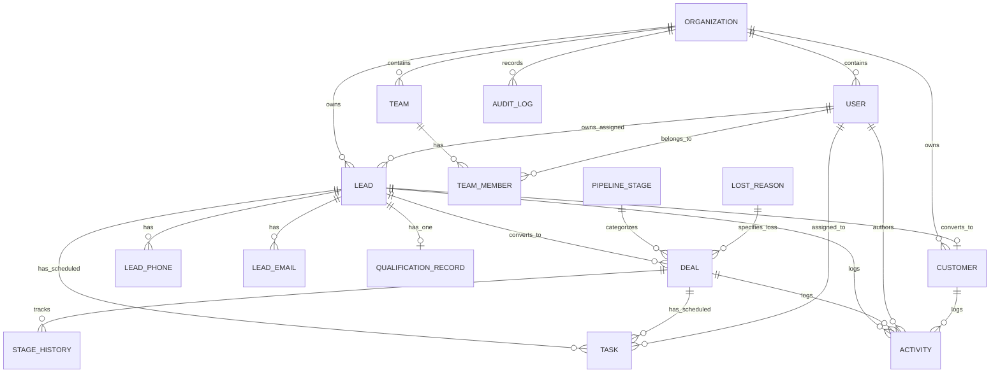

# DigiTechzo CRM — Data Model & Entity Specifications

> **STATUS:** SPECIFICATION / PLANNING  
> **Architecture Classification:** **TARGET DATA MODEL / PROPOSED SCHEMA**  
> **Target Database Engine:** PostgreSQL (Current Recommendation)  
> **Phase:** Phase 0 — Documentation / Planning  
> **Note:** This document defines the conceptual and logical entity relationships, attributes, and constraints. Zero Prisma schemas, SQL DDL, or database migrations are executed in this phase.

---

## 1. Entity Relationship Diagram (Target Conceptual ERD)

---

## 2. Proposed Entity Specifications

### 2.1 Organization (`organizations`)
* **Purpose:** Root tenant entity representing the DigiTechzo organization.
* **Fields:**
  - `id`: UUID (Primary Key)
  - `name`: String (e.g., "DigiTechzo")
  - `slug`: String (Unique)
  - `logoUrl`: String (Nullable)
  - `timezone`: String (Default: "Asia/Kolkata")
  - `currency`: String (Default: "INR")
  - `createdAt`, `updatedAt`: Timestamps

### 2.2 User (`users`)
* **Purpose:** System operators, sales executives, managers, and administrators.
* **Fields:**
  - `id`: UUID (Primary Key)
  - `organizationId`: UUID (Foreign Key -> organizations.id)
  - `email`: String (Unique, Lowercased)
  - `passwordHash`: String (Argon2id hash)
  - `firstName`: String
  - `lastName`: String
  - `phone`: String (Nullable)
  - `role`: Enum (`SUPER_ADMIN`, `ADMIN`, `SALES_MANAGER`, `BDE`, `MARKETING`, `DELIVERY`)
  - `isActive`: Boolean (Default: true)
  - `lastLoginAt`: Timestamp (Nullable)
  - `createdAt`, `updatedAt`, `deletedAt`: Timestamps

### 2.3 Team & TeamMember (`teams`, `team_members`)
* **Purpose:** Groups users into operational units for scoped reporting and lead routing.
* **Fields (`teams`):**
  - `id`: UUID (Primary Key)
  - `organizationId`: UUID (Foreign Key)
  - `name`: String
  - `leaderUserId`: UUID (Foreign Key -> users.id)
* **Fields (`team_members`):**
  - `id`: UUID (Primary Key)
  - `teamId`: UUID (Foreign Key -> teams.id)
  - `userId`: UUID (Foreign Key -> users.id)
  - `isPrimaryTeam`: Boolean (Default: true)

### 2.4 Lead (`leads`)
* **Purpose:** Core entity representing a prospective client inquiry from any channel.
* **Fields:**
  - `id`: UUID (Primary Key)
  - `organizationId`: UUID (Foreign Key)
  - `ownerId`: UUID (Foreign Key -> users.id, Mandatory)
  - `fullName`: String
  - `companyName`: String (Nullable)
  - `title`: String (Job Title, Nullable)
  - `source`: Enum (`META_ADS`, `GOOGLE_ADS`, `WEBSITE_FORM`, `WHATSAPP`, `MANUAL`, `IMPORT`, `PHONE_INBOUND`)
  - `status`: Enum (`NEW`, `HOT`, `WARM`, `COLD`, `UNQUALIFIED`, `CONVERTED`, `LOST`)
  - `leadScore`: Integer (Default: 0)
  - `serviceInterest`: String (Primary requested service)
  - `campaignName`: String (Nullable)
  - `utmSource`, `utmMedium`, `utmCampaign`, `utmTerm`, `utmContent`: Strings (Nullable)
  - `locationCity`, `locationCountry`: Strings (Nullable)
  - `lastActivityAt`: Timestamp
  - `nextActionDueAt`: Timestamp (Nullable)
  - `createdAt`, `updatedAt`, `deletedAt`: Timestamps

### 2.5 LeadPhone & LeadEmail (`lead_phones`, `lead_emails`)
* **Purpose:** Supports multi-phone and multi-email contact points per lead with strict normalization.
* **Fields (`lead_phones`):**
  - `id`: UUID (Primary Key)
  - `leadId`: UUID (Foreign Key -> leads.id)
  - `phoneNumber`: String (Normalized E.164, e.g. "+919876543210")
  - `phoneType`: Enum (`MOBILE`, `WHATSAPP`, `WORK`, `HOME`, `OTHER`)
  - `isPrimary`: Boolean (Default: false)
  - `isWhatsApp`: Boolean (Default: false)
* **Fields (`lead_emails`):**
  - `id`: UUID (Primary Key)
  - `leadId`: UUID (Foreign Key -> leads.id)
  - `email`: String (Normalized lowercase)
  - `emailType`: Enum (`WORK`, `PERSONAL`, `OTHER`)
  - `isPrimary`: Boolean (Default: false)

### 2.6 QualificationRecord (`qualification_records`)
* **Purpose:** Captures detailed BANT qualification criteria and scoring data.
* **Fields:**
  - `id`: UUID (Primary Key)
  - `leadId`: UUID (Unique Foreign Key -> leads.id)
  - `qualifiedByUserId`: UUID (Foreign Key -> users.id)
  - `problemStatement`: Text
  - `budgetAmount`: Decimal (Nullable)
  - `budgetStatus`: Enum (`CONFIRMED`, `ESTIMATED`, `EXPLORING`, `NO_BUDGET`)
  - `authorityLevel`: Enum (`DECISION_MAKER`, `INFLUENCER`, `EVALUATOR`, `GATEKEEPER`)
  - `timelineHorizon`: Enum (`IMMEDIATE_2WEEKS`, `ONE_MONTH`, `THREE_MONTHS`, `EXPLORING`)
  - `urgencyRating`: Integer (1 to 5)
  - `qualificationNotes`: Text (Nullable)
  - `qualifiedAt`: Timestamp

### 2.7 PipelineStage (`pipeline_stages`)
* **Purpose:** Configurable stages representing the sales funnel progression.
* **Fields:**
  - `id`: UUID (Primary Key)
  - `organizationId`: UUID (Foreign Key)
  - `name`: String (e.g. "New Lead", "Qualification", "Meeting Scheduled", "Proposal Sent", "Negotiation", "Won", "Lost")
  - `displayOrder`: Integer
  - `stageType`: Enum (`OPEN`, `WON`, `LOST`)
  - `defaultProbability`: Integer (0 to 100)
  - `isActive`: Boolean (Default: true)

### 2.8 Deal (`deals`)
* **Purpose:** Commercial sales opportunity created for a qualified lead.
* **Fields:**
  - `id`: UUID (Primary Key)
  - `organizationId`: UUID (Foreign Key)
  - `leadId`: UUID (Foreign Key -> leads.id)
  - `ownerId`: UUID (Foreign Key -> users.id)
  - `stageId`: UUID (Foreign Key -> pipeline_stages.id)
  - `title`: String
  - `amount`: Decimal (Monetary value)
  - `currency`: String (Default: "INR")
  - `probability`: Integer (0 to 100)
  - `expectedCloseDate`: Date
  - `status`: Enum (`OPEN`, `WON`, `LOST`)
  - `lostReasonId`: UUID (Nullable, Foreign Key -> lost_reasons.id)
  - `lostReasonDetails`: Text (Nullable)
  - `closedAt`: Timestamp (Nullable)
  - `createdAt`, `updatedAt`, `deletedAt`: Timestamps

### 2.9 StageHistory (`stage_history`)
* **Purpose:** Immutable audit record of every deal stage movement.
* **Fields:**
  - `id`: UUID (Primary Key)
  - `dealId`: UUID (Foreign Key -> deals.id)
  - `previousStageId`: UUID (Foreign Key -> pipeline_stages.id)
  - `newStageId`: UUID (Foreign Key -> pipeline_stages.id)
  - `changedByUserId`: UUID (Foreign Key -> users.id)
  - `durationInPreviousStageSeconds`: BigInt
  - `createdAt`: Timestamp

### 2.10 LostReason (`lost_reasons`)
* **Purpose:** Standardized master list of deal rejection and loss categories.
* **Fields:**
  - `id`: UUID (Primary Key)
  - `organizationId`: UUID (Foreign Key)
  - `code`: String (Unique, e.g., "PRICE_HIGH", "COMPETITOR", "GHOSTED")
  - `label`: String (e.g., "Pricing / Budget Mismatch")
  - `isActive`: Boolean

### 2.11 Task (`tasks`)
* **Purpose:** Scheduled actions underpinning the mandatory "Next Action" follow-up system.
* **Fields:**
  - `id`: UUID (Primary Key)
  - `organizationId`: UUID (Foreign Key)
  - `leadId`: UUID (Nullable, Foreign Key -> leads.id)
  - `dealId`: UUID (Nullable, Foreign Key -> deals.id)
  - `assignedUserId`: UUID (Foreign Key -> users.id)
  - `createdByUserId`: UUID (Foreign Key -> users.id)
  - `title`: String
  - `description`: Text (Nullable)
  - `actionType`: Enum (`CALL`, `WHATSAPP`, `EMAIL`, `MEETING`, `PROPOSAL_FOLLOWUP`, `INTERNAL_REVIEW`)
  - `isNextAction`: Boolean (Default: true)
  - `scheduledDate`: Date
  - `scheduledTime`: Time (Nullable)
  - `priority`: Enum (`LOW`, `MEDIUM`, `HIGH`, `URGENT`)
  - `status`: Enum (`PENDING`, `COMPLETED`, `OVERDUE`, `RESCHEDULED`, `CANCELLED`)
  - `outcomeNotes`: Text (Nullable)
  - `completedAt`: Timestamp (Nullable)
  - `createdAt`, `updatedAt`: Timestamps

### 2.12 Activity & Note (`activities`, `notes`)
* **Purpose:** Unified chronological event stream recording all interactions.
* **Fields (`activities`):**
  - `id`: UUID (Primary Key)
  - `organizationId`: UUID (Foreign Key)
  - `leadId`: UUID (Nullable, Foreign Key -> leads.id)
  - `dealId`: UUID (Nullable, Foreign Key -> deals.id)
  - `customerId`: UUID (Nullable, Foreign Key -> customers.id)
  - `userId`: UUID (Nullable, Foreign Key -> users.id)
  - `type`: Enum (`CALL_LOG`, `WHATSAPP_MESSAGE`, `EMAIL_SENT`, `EMAIL_RECEIVED`, `NOTE_ADDED`, `MEETING_HELD`, `STAGE_CHANGED`, `PROPOSAL_DISPATCHED`, `AI_INSIGHT`)
  - `title`: String
  - `description`: Text (Nullable)
  - `metadata`: JSONB (Stores call duration, audio URL, message payloads, UTM parameters)
  - `createdAt`: Timestamp

### 2.13 Customer (`customers`)
* **Purpose:** Won account record managing delivery handoff, purchased services, and renewals.
* **Fields:**
  - `id`: UUID (Primary Key)
  - `organizationId`: UUID (Foreign Key)
  - `originalLeadId`: UUID (Unique Foreign Key -> leads.id)
  - `accountManagerUserId`: UUID (Foreign Key -> users.id)
  - `companyName`: String
  - `billingAddress`: Text (Nullable)
  - `taxIdentificationNumber`: String (GST / Tax ID, Nullable)
  - `status`: Enum (`ACTIVE`, `INACTIVE`, `CHURNED`)
  - `contractStartDate`: Date
  - `contractEndDate`: Date (Nullable)
  - `totalRevenueRealized`: Decimal (Default: 0)
  - `createdAt`, `updatedAt`: Timestamps

### 2.14 AuditLog (`audit_logs`)
* **Purpose:** Security and compliance trail of all system state changes and exports.
* **Fields:**
  - `id`: UUID (Primary Key)
  - `organizationId`: UUID (Foreign Key)
  - `actorUserId`: UUID (Foreign Key -> users.id)
  - `action`: Enum (`CREATE`, `UPDATE`, `DELETE`, `REASSIGN`, `EXPORT`, `LOGIN`, `FAILED_LOGIN`)
  - `entityName`: String
  - `entityId`: String (Nullable)
  - `ipAddress`: String
  - `userAgent`: String
  - `changesDiff`: JSONB
  - `createdAt`: Timestamp
