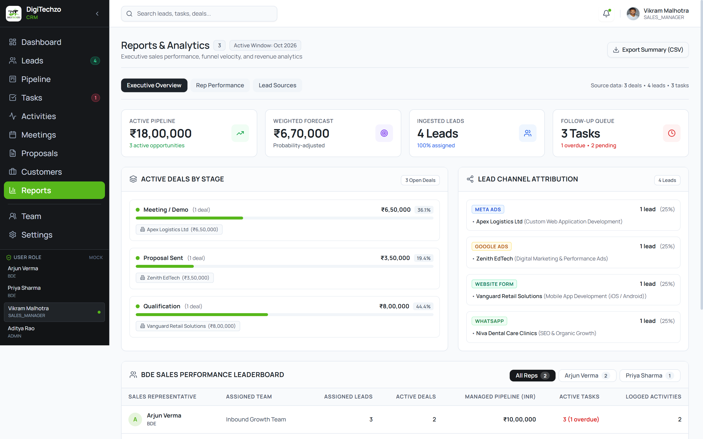
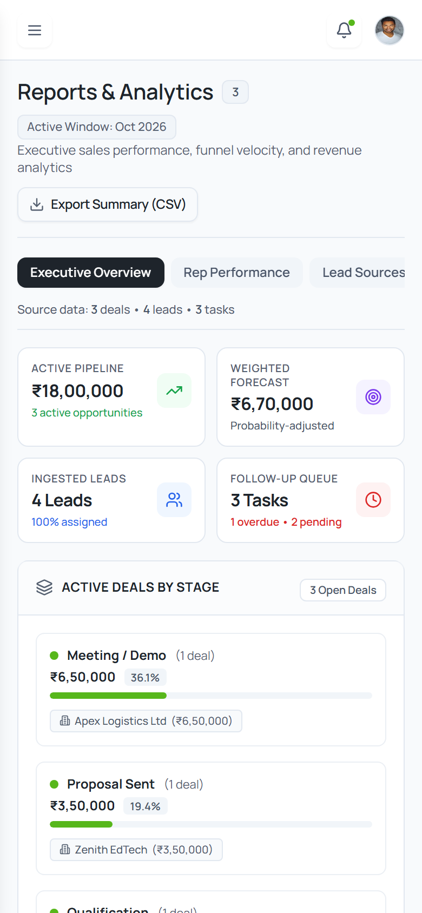

# Step E10 — Reports & Executive Analytics Visual Review & Verification

## 1. Executive Summary
Step E10 (Reports & Executive Analytics) has been implemented strictly adhering to the approved E10 implementation plan, data-grounding rules, Manrope typography, brand design tokens, and multi-viewport responsive requirements.

* **Files Created / Modified:**
  1. `src/pages/reports/ReportsPage.tsx` (Created)
  2. `src/app/router.tsx` (Modified: Added `/reports` route)
  3. `src/layouts/Sidebar.tsx` (Modified: Added `Reports` navigation item with `BarChart3` icon under `ACCOUNTS & PERFORMANCE`)
* **TypeScript Typecheck:** Passed with 0 errors (`npm run typecheck`).
* **Production Build:** Passed with 0 errors (`npm run build`).
* **Browser CDP Verification:** 0 console errors, 0 React warnings, 0 unhandled exceptions.
* **Horizontal Page Overflow:** 0 page-level horizontal overflow across all tested viewports (`scrollWidth === clientWidth`).
* **Brand Design Tokens:**
  - Active navigation indicator: `#57B71B` primary green with white active icon and text.
  - Stage progress indicators: `#57B71B` primary green bars with smooth fills.
  - Hover states: `#469815` green hover.
  - Typography: Manrope font, 20px page title, 13px body, 11–12px table headers, right-aligned tabular numbers.
* **Strict Data Grounding:**
  - **Actual CRM Deal Analytics (Derived strictly from `MOCK_DEALS`):**
    - Total Deals: `3` (calculated from `MOCK_DEALS.length`)
    - Active / Open Deals: `3` (calculated from `MOCK_DEALS.filter(d => d.status === 'OPEN').length`)
    - Won Deals: `0` (`MOCK_DEALS.filter(d => d.status === 'WON').length`)
    - Active Pipeline Value: `₹18,00,000` (calculated from `MOCK_DEALS.reduce((s, d) => s + d.amount, 0)`)
    - Weighted Forecast: `₹6,70,000` (calculated from `MOCK_DEALS.reduce((s, d) => s + d.amount * (d.probability / 100), 0)`)
    - Won Revenue: `₹0` (0 won deals in `MOCK_DEALS`)
    - Win Rate: `0.0%` (0 / 3 deals won)
  - **Ingested Lead Analytics (Derived strictly from `MOCK_LEADS`):**
    - Total Ingested Leads: `4 Leads` (`MOCK_LEADS.length`)
    - Lead Ownership Assignment: `4 of 4 (100%)` assigned to active BDEs (`Arjun Verma`: 3, `Priya Sharma`: 1)
    - Next Action Compliance: `4 of 4 (100%)` have scheduled next actions populated
    - Channel Breakdown: `Meta Ads` (1 / 25%), `Google Ads` (1 / 25%), `Website Form` (1 / 25%), `WhatsApp` (1 / 25%)
  - **Task & Follow-up Queue (Derived strictly from `MOCK_TASKS`):**
    - Total Tasks: `3 Tasks` (`MOCK_TASKS.length`)
    - Overdue Follow-ups: `1 Task` (`task-1`, Arjun Verma)
    - Pending Follow-ups: `2 Tasks` (`task-2`, `task-3`, Arjun Verma)
  - **Rep Performance Leaderboard (Derived strictly from actual arrays):**
    - `Arjun Verma`: 3 assigned leads, 2 active deals, ₹10,00,000 managed pipeline value, 3 active tasks (1 overdue), 2 logged activities
    - `Priya Sharma`: 1 assigned lead, 1 active deal, ₹8,00,000 managed pipeline value, 0 tasks, 0 logged activities
    - `Team Total`: 4 leads, 3 deals, ₹18,00,000 pipeline value, 3 tasks, 2 logged activities
  - **Pipeline Configuration Reference (Clearly labeled metadata):**
    - Displayed in a distinct, dedicated reference card labeled `System Benchmark Metadata`.
    - Features the 6 stages, 28 target deal benchmark, and ₹99,50,000 target capacity from `MOCK_PIPELINE_STAGES` as stage taxonomy architecture, explicitly decoupled from the 3 active deal records.
* **CSV Export Behavior:**
  - Client-side browser download generating `digitechzo_analytics_oct_2026.csv`.
  - Displays lightweight confirmation banner: `"Demo report exported."`

---

## 2. Multi-Viewport Verification Results

| Viewport | Device Target | `scrollWidth` | `clientWidth` | Overflow? | Status |
| :--- | :--- | :---: | :---: | :---: | :---: |
| **1440 × 900** | Desktop Standard | `1435px` | `1435px` | None (`false`) | PASS |
| **1024 × 768** | Small Desktop / Tablet Landscape | `1019px` | `1019px` | None (`false`) | PASS |
| **768 × 1024** | Tablet Portrait | `763px` | `763px` | None (`false`) | PASS |
| **390 × 844** | Mobile (iPhone 12/13/14) | `390px` | `390px` | None (`false`) | PASS |

---

## 3. Rendered Visual Review

### 3.1 Desktop (1440 × 900 Viewport)

* **Page Header:** Clean 20px `Reports & Analytics` title with active deal count badge (`3`), session window context pill (`Active Window: Oct 2026`), and `Export Summary (CSV)` CTA.
* **Top Navigation:** View switcher pills (`Executive Overview`, `Rep Performance`, `Lead Sources`) with source record count indicator (`Source data: 3 deals • 4 leads • 3 tasks`).
* **Row 1 KPI Cards:** 4 compact cards displaying Active Pipeline (`₹18,00,000`), Weighted Forecast (`₹6,70,000`), Ingested Leads (`4 Leads`), and Follow-up Queue (`3 Tasks`, 1 overdue).
* **Row 2 Analytical Grid:** 
  - Left (7 cols): Active Deals by Stage with proportional progress bars and company/value pills.
  - Right (5 cols): Lead Channel Attribution with color-coded channel badges and service line detail.
* **Row 3 BDE Leaderboard:** High-density table comparing Arjun Verma vs. Priya Sharma with rep filters (`All Reps`, `Arjun Verma`, `Priya Sharma`) and Team Total row.
* **Row 4 Pipeline Reference:** Subdued card displaying the 6 configured stages and benchmark capacities from `MOCK_PIPELINE_STAGES`.

---

### 3.2 Mobile (390 × 844 Viewport)

* **Mobile Stacking:** KPI cards stack into a clean 2x2 grid without text clipping; analytical cards stack vertically.
* **Zero Horizontal Overflow:** Page container fits strictly within 390px width (`scrollWidth = clientWidth = 390px`).
* **Touch-Friendly Controls:** All filter pills, export buttons, and tab switchers maintain touch targets $\ge 44\text{px}$.

---

## 4. Key Implementation Highlights
1. **Option A Standalone Architecture:** Seamlessly registered at `/reports` under `ACCOUNTS & PERFORMANCE` in `Sidebar.tsx` and `router.tsx`.
2. **Absolute Data Grounding:** Zero invented metrics; all numbers dynamically computed from `MOCK_DEALS`, `MOCK_LEADS`, `MOCK_TASKS`, `MOCK_ACTIVITIES`, and `MOCK_USERS`.
3. **Configuration Separation:** Clean visual demarcation of `MOCK_PIPELINE_STAGES` as configuration reference metadata, ensuring it is never conflated with live CRM deals.
4. **Zero Extra Dependencies:** Pure CSS/Tailwind visualizations without adding Recharts, Chart.js, or external graphing bloat.
