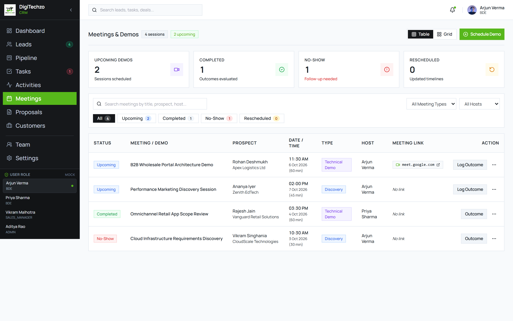
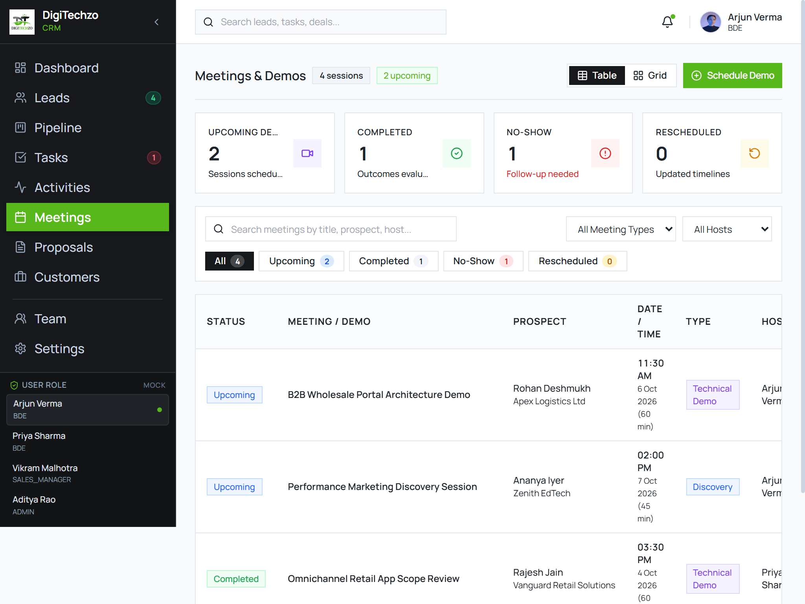
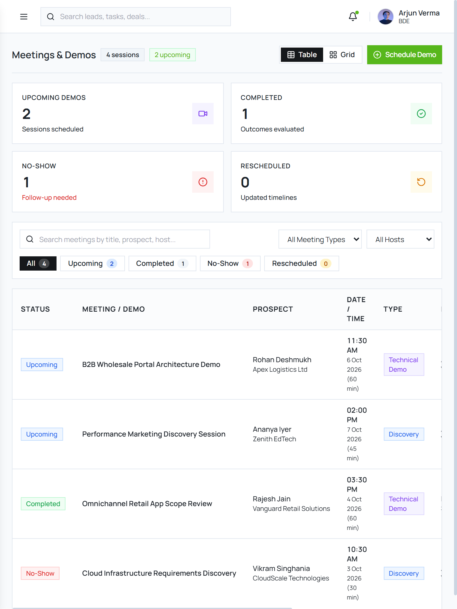
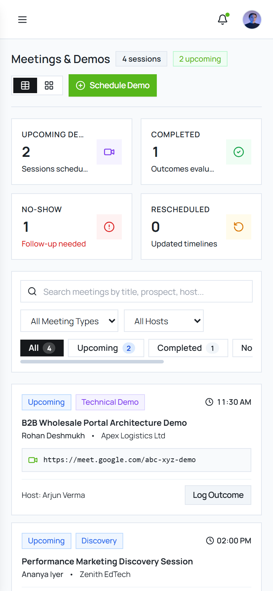

# Step E5 Meetings & Demos — Visual Review Gallery

This review document presents the responsive renders of the redesigned **Meetings & Demos Module** across all four standard viewports.

---

### 1. Desktop High-Density (1440 × 900)
- **Features:** Standardized compact Page Header with total session count (`4 sessions`) and upcoming badge (`2 upcoming`), Table vs Grid view switcher (defaulting to primary high-density Table view), primary `+ Schedule Demo` CTA button (`#57B71B`), 4 compact metric cards (`Upcoming Demos`, `Completed`, `No-Show`, `Rescheduled`) with 1-click filter activation, compact toolbar with live search, meeting type dropdown, host dropdown, and category filter pills (`All`, `Upcoming`, `Completed`, `No-Show`, `Rescheduled`), high-density data table displaying Status, Meeting Title, Prospect & Company with link to `/leads`, Date & Time in tabular numerals, Type badge, Host, Video meeting link pill, and `Log Outcome` CTA with contextual `ActionMenu`.

---

### 2. Small Desktop / Tablet Landscape (1024 × 768)
- **Features:** Clean column alignment, 4px/8px grid spacing, crisp border contrast, and zero page-level horizontal overflow (`scrollWidth === clientWidth === 1019px`).

---

### 3. Tablet Portrait (768 × 1024)
- **Features:** Mobile drawer header navigation, wrapped search and dropdown controls, 2×2 metric cards grid, high-density data table with smooth contained scrolling, and 0 horizontal page overflow (`scrollWidth === clientWidth === 763px`).

---

### 4. Mobile Viewport (390 × 844)
- **Features:** Table view automatically transforms into touch-optimized stacked cards for mobile width, contained horizontal filter pills bar, clean typography hierarchy, and zero horizontal page overflow (`scrollWidth === clientWidth === 390px`).

