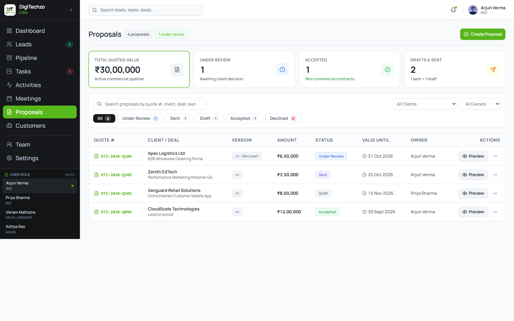
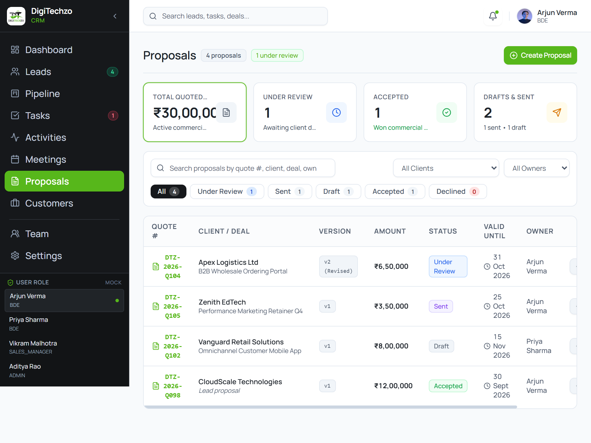
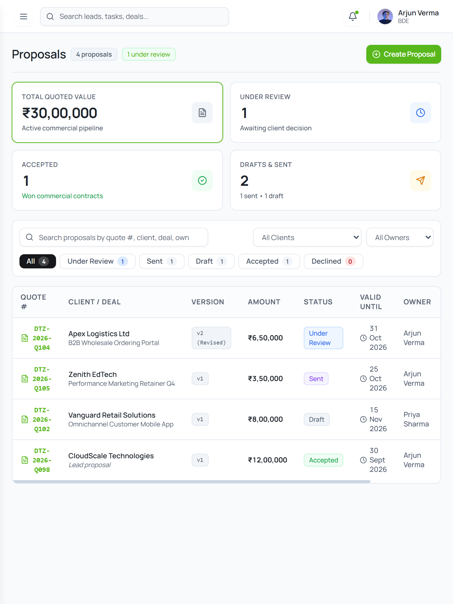
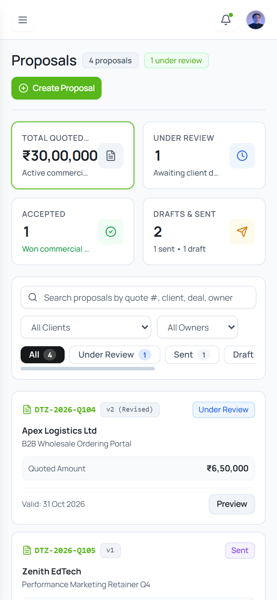

# Step E6 Proposals & Quotes — Visual Review Gallery

This review document presents the responsive renders of the redesigned **Proposals & Quotes Module** across all four standard viewports.

---

### 1. Desktop High-Density (1440 × 900)
- **Features:** Standardized compact Page Header with total count (`4 proposals`) and active status badge (`1 under review`), primary `+ Create Proposal` CTA button (`#57B71B`), 4 compact metric cards (`Total Quoted Value`, `Under Review`, `Accepted`, `Drafts & Sent`) with 1-click filter activation, compact toolbar with live search, client dropdown filter, owner dropdown filter, and category filter pills (`All`, `Under Review`, `Sent`, `Draft`, `Accepted`, `Declined`), primary high-density data table displaying Quote #, Client & Deal with direct link to `/leads`, Version pill (`v2 (Revised)`, `v1`), Quoted Amount in bold tabular Rupee format (`₹6,50,000`), Status badge, Valid Until date with tabular calendar formatting, Owner name, and `Preview` action button with contextual `ActionMenu`.

---

### 2. Small Desktop / Tablet Landscape (1024 × 768)
- **Features:** Clean multi-column alignment, tight 4px/8px grid spacing, crisp border contrast, and zero page-level horizontal overflow (`scrollWidth === clientWidth === 1024px`).

---

### 3. Tablet Portrait (768 × 1024)
- **Features:** Mobile drawer header navigation, wrapped search and dropdown controls, 2×2 metric cards grid, high-density data table with smooth contained scrolling, and 0 horizontal page overflow (`scrollWidth === clientWidth === 768px`).

---

### 4. Mobile Viewport (390 × 844)
- **Features:** Table view automatically transforms into touch-optimized stacked document cards for mobile width, contained horizontal filter pills bar, clean typography hierarchy, and zero horizontal page overflow (`scrollWidth === clientWidth === 390px`).

