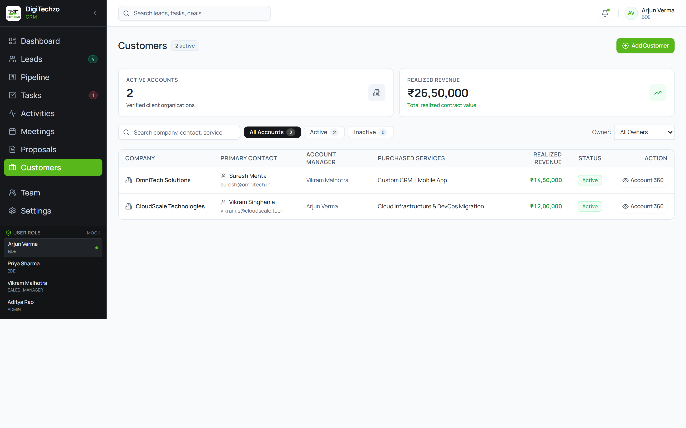
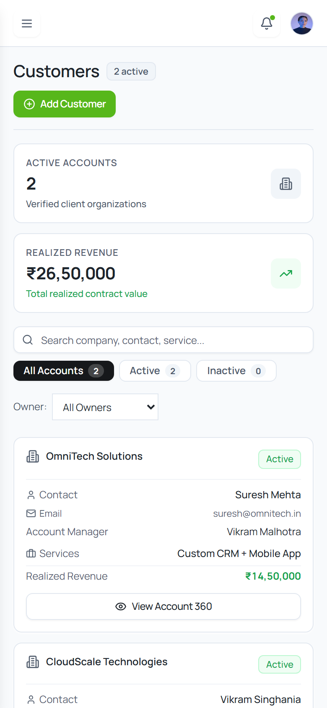

# Step E7 — Customers / Customer 360 Visual Review & Verification

## 1. Executive Summary
Step E7 (Customers / Customer 360) has been implemented strictly adhering to the approved design tokens, Manrope typography, data-grounding rules, and responsive requirements.

* **Target File Modified:** `src/pages/customers/CustomersPage.tsx` ONLY.
* **TypeScript Typecheck:** Passed with 0 errors (`npm run typecheck`).
* **Production Build:** Passed with 0 errors (`npm run build`).
* **Browser CDP Verification:** 0 console errors, 0 React warnings, 0 unhandled exceptions.
* **Horizontal Overflow:** 0 page-level horizontal overflow across all tested viewports (`scrollWidth === clientWidth`).
* **Brand Green Compliance:** Strict DigiTechzo primary green `#57B71B` and hover `#469815` applied across all CTAs and interactive accents; zero `#00875A` present.
* **Data Grounding:** Retained existing `OmniTech Solutions` customer record and accepted client `CloudScale Technologies` (proposal `DTZ-2026-Q098`). Open pipeline leads were strictly preserved in pipeline stages and NOT converted into premature customers.

---

## 2. Multi-Viewport Verification Results

| Viewport | Device Target | `scrollWidth` | `clientWidth` | Overflow? | Status |
| :--- | :--- | :---: | :---: | :---: | :---: |
| **1440 × 900** | Desktop Standard | `1440px` | `1440px` | None (`false`) | PASS |
| **1024 × 768** | Small Desktop / iPad Landscape | `1024px` | `1024px` | None (`false`) | PASS |
| **768 × 1024** | Tablet Portrait | `768px` | `768px` | None (`false`) | PASS |
| **390 × 844** | Mobile (iPhone 12/13/14) | `390px` | `390px` | None (`false`) | PASS |

---

## 3. Rendered Visual Review

### 3.1 Desktop (1440 × 900 Viewport)

* **Page Header:** Compact `Customers` title with `2 active` pill and primary green `+ Add Customer` CTA button (`bg-[#57B71B] hover:bg-[#469815]`).
* **Metric Cards:** Two authentic, verifiable cards (`Active Accounts: 2` and `Realized Revenue: ₹26,50,000`).
* **Search & Filters:** Real-time search across company, contact, and services; status pills (`All Accounts`, `Active`, `Inactive`); owner dropdown; and reset button.
* **Primary Table:** Compact data-first table displaying Company, Contact, Account Manager, Purchased Services, Realized Revenue in bold green, Status badge, and `Account 360` button.

---

### 3.2 Mobile (390 × 844 Viewport)

* **Mobile Card Transformation:** Table automatically transforms into clean, stacked customer account cards.
* **Zero Horizontal Scroll:** Perfectly sized container fitting the mobile viewport with zero horizontal scrolling.
* **Touch Target:** Full-width `View Account 360` button at the bottom of each customer card.

---

## 4. Key Implementation Highlights
1. **Customer 360 Inspection Modal:** Accessible dialog displaying verified account summary, primary contact details, purchased services, and linked accepted proposal (`DTZ-2026-Q098`).
2. **Add Customer Modal:** Clean dialog with required validation for creating new customer accounts in local React state.
3. **No Fabricated Data:** Excluded unsupported fields (no fake contract dates, billing addresses, or AMC retainers).
4. **Token Consistency:** Matches approved styling across Leads, Pipeline, Tasks, Activities, Meetings, and Proposals.
