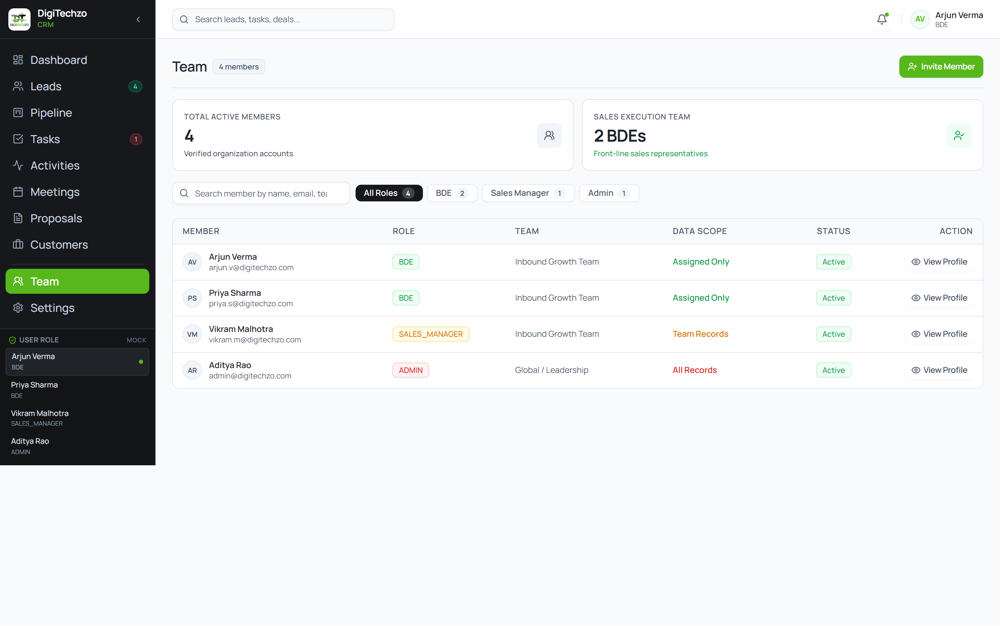
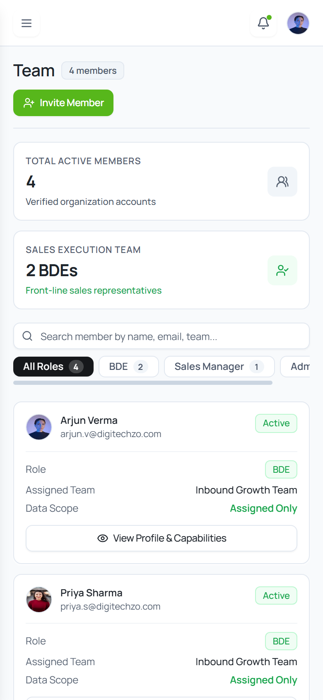

# Step E8 — Team & RBAC / Organization Members Visual Review & Verification

## 1. Executive Summary
Step E8 (Team & RBAC / Organization Members) has been implemented strictly adhering to the approved design tokens, Manrope typography, data-grounding rules, and responsive requirements.

* **Target File Modified:** `src/pages/team/TeamPage.tsx` ONLY.
* **TypeScript Typecheck:** Passed with 0 errors (`npm run typecheck`).
* **Production Build:** Passed with 0 errors (`npm run build`).
* **Browser CDP Verification:** 0 console errors, 0 React warnings, 0 unhandled exceptions.
* **Horizontal Overflow:** 0 page-level horizontal overflow across all tested viewports (`scrollWidth === clientWidth`).
* **Brand Green Compliance:** Strict DigiTechzo primary green `#57B71B` and hover `#469815` applied on `+ Invite Member` CTA button; zero `#00875A` present.
* **Data Grounding:** Retained all 4 existing `MOCK_USERS` records (Arjun Verma, Priya Sharma, Vikram Malhotra, Aditya Rao). No fabricated employees or external identity providers.
* **RBAC Grounding:** Role-based capabilities strictly reflect `docs/AUTH-RBAC.md` Section 2.2 and `docs/BUSINESS-RULES.md`.
* **Invite Member Scope:** Operates as frontend demo/local React state only with clear notice that no email is sent and no persistent account is created.

---

## 2. Multi-Viewport Verification Results

| Viewport | Device Target | `scrollWidth` | `clientWidth` | Overflow? | Status |
| :--- | :--- | :---: | :---: | :---: | :---: |
| **1440 × 900** | Desktop Standard | `1440px` | `1440px` | None (`false`) | PASS |
| **1024 × 768** | Small Desktop / Tablet Landscape | `1024px` | `1024px` | None (`false`) | PASS |
| **768 × 1024** | Tablet Portrait | `768px` | `768px` | None (`false`) | PASS |
| **390 × 844** | Mobile (iPhone 12/13/14) | `390px` | `390px` | None (`false`) | PASS |

---

## 3. Rendered Visual Review

### 3.1 Desktop (1440 × 900 Viewport)

* **Page Header:** Compact `Team` title with `4 members` count badge and primary green `+ Invite Member` CTA button (`bg-[#57B71B] hover:bg-[#469815]`).
* **Metric Cards:** Two authentic summary cards (`Total Active Members: 4` and `Sales Execution Team: 2 BDEs`).
* **Search & Filters:** Real-time search across member name, email, and team; role pills (`All Roles`, `BDE`, `Sales Manager`, `Admin`); and reset button.
* **Primary Table:** Compact data-first table displaying Avatar, Member Name, Email, Role badge, Assigned Team, Data Scope badge, Status badge, and `View Profile` button.

---

### 3.2 Mobile (390 × 844 Viewport)

* **Mobile Card Transformation:** Table automatically transforms into clean, stacked member cards.
* **Zero Horizontal Scroll:** Container fits the mobile viewport with zero horizontal scrolling.
* **Touch Target:** Full-width `View Profile & Capabilities` button at the bottom of each member card.

---

## 4. Key Implementation Highlights
1. **Member Profile & RBAC Modal:** Displays member details and a verified capability table derived directly from `docs/AUTH-RBAC.md` Section 2.2 (User Management, Lead Visibility, Pipeline Moves, Lead Reassignment, Commercial Approvals, Export Restrictions, Audit Logs).
2. **Invite Member Modal (Frontend Demo):** Clean dialog with prominent notice informing users that invite is a local frontend demo with no email or database persistence.
3. **Token Consistency:** Matches approved styling across Leads, Pipeline, Tasks, Activities, Meetings, Proposals, and Customers.
