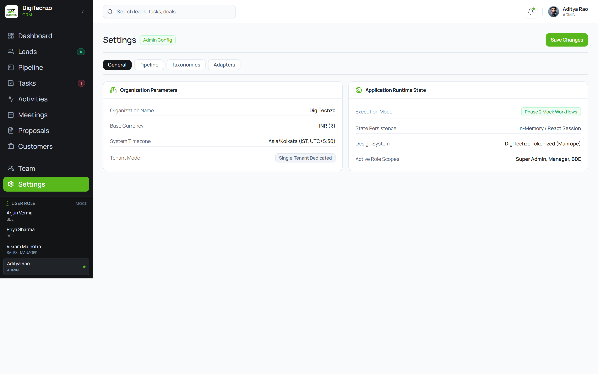
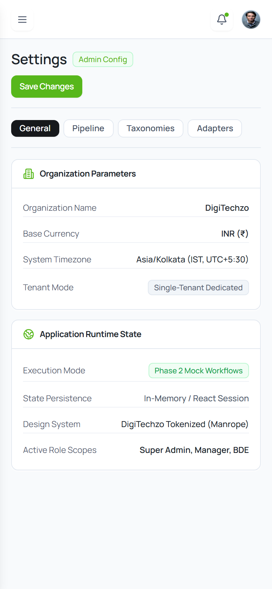

# Step E9 — Settings & System Configuration Visual Review & Verification

## 1. Executive Summary
Step E9 (Settings & System Configuration) has been implemented strictly adhering to the approved design tokens, Manrope typography, data-grounding rules, and responsive requirements.

* **Target File Modified:** `src/pages/settings/SettingsPage.tsx` ONLY.
* **TypeScript Typecheck:** Passed with 0 errors (`npm run typecheck`).
* **Production Build:** Passed with 0 errors (`npm run build`).
* **Browser CDP Verification:** 0 console errors, 0 React warnings, 0 unhandled exceptions.
* **Horizontal Overflow:** 0 page-level horizontal overflow across all tested viewports (`scrollWidth === clientWidth`).
* **Brand Green Compliance:** Strict DigiTechzo primary green `#57B71B` and hover `#469815` applied on `Save Changes` CTA button.
* **Data Grounding:**
  * Pipeline deal counts derived dynamically from `MOCK_DEALS.filter(d => d.stageId === stage.id).length` (verified counts: `0`, `1`, `1`, `1`, `0`, `0`). Zero hardcoded deal counts.
  * Lost reasons match documented `BR-PIPE-02` codes (`PRICE_TOO_HIGH`, `COMPETITOR_CHOSEN`, etc.).
  * Lead sources match `LeadSource` types from `crm.ts`.
  * Service lines match `MOCK_LEADS`.
  * Integration adapter statuses accurately reflect Phase 2 mock mode and planned phases.
* **Save Changes Behavior:** Session-scoped local confirmation badge (`"Changes saved for this session."`). Zero API calls, zero database writes, zero localStorage.

---

## 2. Multi-Viewport Verification Results

| Viewport | Device Target | `scrollWidth` | `clientWidth` | Overflow? | Status |
| :--- | :--- | :---: | :---: | :---: | :---: |
| **1440 × 900** | Desktop Standard | `1440px` | `1440px` | None (`false`) | PASS |
| **1024 × 768** | Small Desktop / Tablet Landscape | `1024px` | `1024px` | None (`false`) | PASS |
| **768 × 1024** | Tablet Portrait | `768px` | `768px` | None (`false`) | PASS |
| **390 × 844** | Mobile (iPhone 12/13/14) | `390px` | `390px` | None (`false`) | PASS |

---

## 3. Rendered Visual Review

### 3.1 Desktop (1440 × 900 Viewport)

* **Page Header:** Compact `Settings` title with `Admin Config` badge and primary green `Save Changes` button (`bg-[#57B71B] hover:bg-[#469815]`).
* **Category Navigation:** Compact category pills (`General`, `Pipeline`, `Taxonomies`, `Adapters`).
* **Section Cards:** Clean, data-first parameter cards displaying Organization Parameters and Application Runtime State with zero clutter.

---

### 3.2 Mobile (390 × 844 Viewport)

* **Mobile Stacking:** Category tabs and cards stack seamlessly with zero horizontal overflow.
* **Compact Controls:** Touch-friendly buttons and badges scaled to mobile viewports.

---

## 4. Key Implementation Highlights
1. **Option A Compact Tabs:** Fast, clean switching between General Profile, Pipeline Stages, Taxonomies & Loss Governance, and Integration Adapters.
2. **Accurate Adapter Framing:** Clearly labels WhatsApp/Telephony adapters as `Planned / Not Connected` and storage/database as `Mock Mode`.
3. **Strict Design Tokens:** 100% compliant with DigiTechzo CRM brand tokens and Manrope font system.
