# DigiTechzo CRM — Full Frontend ↔ Backend ↔ Database Integration Audit

> **Phase**: Diagnosis Only — Zero Code or Data Modifications  
> **Date**: October 7, 2026  
> **Branch**: `kaniga`  
> **Environment**: Windows | Node.js v24.18.1 | PostgreSQL (Port 5432) | NestJS (Port 4000) | Vite/React 19 (Port 5173) | MariaDB (Port 3306 - Untouched)

---

## 1. Executive Summary

A comprehensive, live, read-only integration audit was conducted across the three tiers of the DigiTechzo CRM:
1. **PostgreSQL Database** (`digitechzo_crm` via Prisma ORM)
2. **NestJS Backend Core APIs** (`@digitechzo/api` v1.0.0 on port 4000)
3. **React 19 + Vite Frontend SPA** (`digitechzo-crm` on port 5173)

### Core Diagnosis & Findings
1. **The Disconnection Phenomenon**: While Phase 3 Core Backend is fully built and passes all 11 NestJS test suites (90/90 tests), **7 out of 9 core sales pages in the frontend are still 100% disconnected from the backend API**. They continue to render Phase-2 mock datasets (`MOCK_DEALS`, `MOCK_TASKS`, `MOCK_ACTIVITIES`, `MOCK_USERS`) or internal hardcoded state (`INITIAL_MEETINGS`, `INITIAL_PROPOSALS`, `INITIAL_CUSTOMERS`).
2. **The Only Connected Pages**:
   - **Authentication (`/login`)**: 100% connected to `POST /api/v1/auth/login`. Issues real JWTs and persists sessions.
   - **Dashboard (`/dashboard`)**: Connected to real APIs (`crmApi.getLeads`, `getDeals`, `getTasks`, `getActivities`). Correctly calculates live metrics from API data and shows zero/empty states when database tables are empty.
   - **Leads (`/leads`)**: Connected to real APIs (`crmApi.getLeads`, `createLead`, `updateLead`, `deleteLead`). Successfully reads and persists PostgreSQL lead records (e.g. lead "Kaniga").
3. **Critical RBAC Blocker Found**: The database table `permissions` has **0 rows** and `role_permissions` has **0 rows**. As a result, when any authenticated user (even `ADMIN`) logs in, their JWT payload contains `permissions: []`. Because backend controllers enforce `@Permissions(...)` via a global `PermissionsGuard` that lacks an admin bypass, direct calls to permission-guarded endpoints (like `/deals`, `/tasks`, `/activities`, `/meetings`, `/proposals`, `/customers`) return `403 Forbidden: Missing required permission(s)`.
4. **Missing Backend Controllers**: There are no controllers or public endpoints for **Users/Team management** (`/users` list), **Settings**, **Reports/Analytics**, **Roles**, **Permissions**, **Pipeline Stages**, or **Lost Reasons**.
5. **Schema & Naming Mismatches**: Notable discrepancies exist between frontend types and backend DTOs (e.g. `Deal.value` in backend vs `Deal.amount` in frontend; `Task.taskType` vs `actionType`; `Customer` schema completely different).

---

## 2. Architecture & Data Flow Diagram

```mermaid
flowchart TD
    subgraph Browser ["Frontend Client (React 19 / Vite :5173)"]
        UI_Login["/login (LoginPage)"]
        UI_Dash["/dashboard (DashboardPage)"]
        UI_Leads["/leads (LeadsPage)"]
        UI_Deals["/pipeline (PipelinePage)"]
        UI_Tasks["/tasks (TasksPage)"]
        UI_Acts["/activities (ActivitiesPage)"]
        UI_Meet["/meetings (MeetingsPage)"]
        UI_Prop["/proposals (ProposalsPage)"]
        UI_Cust["/customers (CustomersPage)"]
        UI_Team["/team (TeamPage)"]
        UI_Rep["/reports (ReportsPage)"]
        UI_Set["/settings (SettingsPage)"]

        MockData["src/mocks/mockData.ts<br/>& mockAuth.ts"]
        ApiClient["src/lib/api.ts<br/>(apiFetch / authApi / crmApi)"]
    end

    subgraph Backend ["Backend API (NestJS :4000)"]
        AuthCtrl["Auth Controller"]
        LeadsCtrl["Leads Controller"]
        DealsCtrl["Deals Controller"]
        TasksCtrl["Tasks Controller"]
        ActsCtrl["Activities Controller"]
        MeetCtrl["Meetings Controller"]
        PropCtrl["Proposals Controller"]
        CustCtrl["Customers Controller"]
        UsersCtrl["Users Controller (/me only)"]
        
        PermGuard{"PermissionsGuard<br/>(Checks JWT.permissions)"}
    end

    subgraph Database ["PostgreSQL (Port 5432)"]
        DB_Users[("users (1)")]
        DB_Org[("organizations (1)")]
        DB_Roles[("roles (5)")]
        DB_Perms[("permissions (0) ⚠️")]
        DB_RolePerms[("role_permissions (0) ⚠️")]
        DB_Tokens[("refresh_tokens (17)")]
        DB_Audit[("audit_logs (3)")]
        DB_Leads[("leads (1)")]
        DB_Deals[("deals (0)")]
        DB_Tasks[("tasks (0)")]
        DB_Acts[("activities (0)")]
        DB_Meet[("meetings (0)")]
        DB_Prop[("proposals (0)")]
        DB_Cust[("customers (0)")]
        DB_Stages[("pipeline_stages (0) ⚠️")]
        DB_Lost[("lost_reasons (0) ⚠️")]
    end

    %% Connections
    UI_Login --> ApiClient
    UI_Dash --> ApiClient
    UI_Leads --> ApiClient

    UI_Deals -.->|Reads Local State| MockData
    UI_Tasks -.->|Reads Local State| MockData
    UI_Acts -.->|Reads Local State| MockData
    UI_Meet -.->|Reads Local State| MockData
    UI_Prop -.->|Reads Local State| MockData
    UI_Cust -.->|Reads Local State| MockData
    UI_Team -.->|Reads Local State| MockData
    UI_Rep -.->|Reads Local State| MockData
    UI_Set -.->|Reads Local State| MockData

    ApiClient --> AuthCtrl
    ApiClient --> LeadsCtrl
    ApiClient --> DealsCtrl
    ApiClient --> TasksCtrl
    ApiClient --> ActsCtrl
    ApiClient --> MeetCtrl
    ApiClient --> PropCtrl
    ApiClient --> CustCtrl
    ApiClient --> UsersCtrl

    DealsCtrl --> PermGuard
    TasksCtrl --> PermGuard
    ActsCtrl --> PermGuard
    MeetCtrl --> PermGuard
    PropCtrl --> PermGuard
    CustCtrl --> PermGuard
    LeadsCtrl --> PermGuard

    AuthCtrl --> DB_Users
    AuthCtrl --> DB_Tokens
    AuthCtrl --> DB_Audit
    LeadsCtrl --> DB_Leads
    DealsCtrl --> DB_Deals
    TasksCtrl --> DB_Tasks
    ActsCtrl --> DB_Acts
    MeetCtrl --> DB_Meet
    PropCtrl --> DB_Prop
    CustCtrl --> DB_Cust
```

---

## 3. Database Model Inventory (Live PostgreSQL Counts)

Queried directly against `digitechzo_crm` on PostgreSQL (port 5432) at 16:38 local time:

| Model Name | Table Name | Important Columns | Soft Delete? | Tenant Field | Owner / Assignee | Live DB Count | Status |
|------------|------------|-------------------|--------------|--------------|------------------|---------------|--------|
| `User` | `users` | id, email, name, role_id, organization_id, status | No (status) | `organization_id` | N/A | **1** | Active Admin Seeded |
| `Organization` | `organizations` | id, name, slug, status | No | Self (`id`) | N/A | **1** | DigiTechzo Media |
| `Role` | `roles` | id, name, description, is_system | No | None (Global) | N/A | **5** | ADMIN, MANAGER, BDE_SALES, MARKETING, DELIVERY |
| `Permission` | `permissions` | id, resource, action, description | No | None | N/A | **0** ⚠️ | **Empty (Unseeded)** |
| `RolePermission` | `role_permissions` | id, role_id, permission_id | No | None | N/A | **0** ⚠️ | **Empty (Unseeded)** |
| `RefreshToken` | `refresh_tokens` | id, user_id, token_hash, is_revoked, expires_at | Revocation | Via `user_id` | N/A | **17** | Active session records |
| `AuditLog` | `audit_logs` | id, organization_id, user_id, action, resource | Immutable | `organization_id` | `user_id` | **3** | Lead created, Token rotated, Login success |
| `PipelineStage` | `pipeline_stages` | id, name, order, stage_type, benchmarks | No | None (Reference) | N/A | **0** ⚠️ | **Empty (Unseeded)** |
| `LostReason` | `lost_reasons` | id, code, label, is_active | No (flag) | None (Reference) | N/A | **0** ⚠️ | **Empty (Unseeded)** |
| `Lead` | `leads` | id, full_name, phone, email, status, priority, owner_id | `deleted_at` | `organization_id` | `owner_id` | **1** | Kaniga (+918122289508) |
| `LeadQualification` | `lead_qualifications` | id, lead_id, budget_amount, budget_status, urgency_rating | Cascade | Via `lead_id` | `qualified_by_user_id` | **0** | No BANT records |
| `Deal` | `deals` | id, title, value, stage_id, status, expected_close_date | `deleted_at` | `organization_id` | `owner_id` | **0** | Awaiting CRM pipeline deals |
| `Task` | `tasks` | id, title, task_type, priority, status, due_date | `deleted_at` | `organization_id` | `assignee_id` | **0** | Awaiting tasks |
| `Activity` | `activities` | id, type, direction, channel, subject, occurred_at | Immutable | `organization_id` | `user_id` | **0** | Awaiting interaction logs |
| `Meeting` | `meetings` | id, title, meeting_type, status, start_time, duration | `deleted_at` | `organization_id` | `host_id` | **0** | Awaiting scheduled demos |
| `Proposal` | `proposals` | id, quote_number, version, total_amount, status | `deleted_at` | `organization_id` | `author_id` | **0** | Awaiting quotations |
| `Customer` | `customers` | id, company_name, email, phone, status, lifetime_value | `deleted_at` | `organization_id` | None | **0** | Awaiting onboarded clients |

---

## 4. Backend API Inventory

The NestJS backend implements 10 controllers:

| Controller | Base Route | Implemented Endpoints | Auth | RBAC Decorators | Organization Scoping |
|------------|------------|-----------------------|------|-----------------|----------------------|
| `AuthController` | `/api/v1/auth` | `POST /login`, `POST /logout`, `POST /refresh`, `GET /me` | Public (Login) / JWT (Others) | None | Authenticated user org |
| `HealthController` | `/api/v1/health` | `GET /health` | Public | None | N/A |
| `UsersController` | `/api/v1/users` | `GET /users/me` | JWT | None | Current user org |
| `LeadsController` | `/api/v1/leads` | `GET /`, `POST /`, `GET /:id`, `PATCH /:id`, `DELETE /:id`, `PUT /:id/qualification`, `PATCH /:id/status`, `PATCH /:id/priority-temperature`, `PATCH /:id/next-action` | JWT | `leads:read`, `leads:create`, `leads:update`, `leads:delete` | Enforced in Service (`where: { organizationId }`) |
| `DealsController` | `/api/v1/deals` | `GET /`, `POST /`, `GET /:id`, `PATCH /:id`, `DELETE /:id`, `PATCH /:id/stage`, `PATCH /:id/won`, `PATCH /:id/lost`, `PATCH /:id/assign` | JWT | `deals:read`, `deals:create`, `deals:update`, `deals:delete` | Enforced in Service (`where: { organizationId }`) |
| `TasksController` | `/api/v1/tasks` | `GET /`, `POST /`, `GET /:id`, `PATCH /:id`, `DELETE /:id`, `PATCH /:id/complete`, `PATCH /:id/assign` | JWT | `tasks:read`, `tasks:create`, `tasks:update`, `tasks:delete` | Enforced in Service (`where: { organizationId }`) |
| `ActivitiesController` | `/api/v1/activities` | `GET /`, `POST /`, `GET /:id` | JWT | `activities:read`, `activities:create` | Enforced in Service (`where: { organizationId }`) |
| `MeetingsController` | `/api/v1/meetings` | `GET /`, `POST /`, `GET /:id`, `PATCH /:id`, `DELETE /:id`, `PATCH /:id/complete`, `PATCH /:id/cancel`, `PATCH /:id/assign` | JWT | `meetings:read`, `meetings:create`, `meetings:update`, `meetings:delete` | Enforced in Service (`where: { organizationId }`) |
| `ProposalsController` | `/api/v1/proposals` | `GET /`, `POST /`, `GET /:id`, `PATCH /:id`, `DELETE /:id`, `PATCH /:id/status` | JWT | `proposals:read`, `proposals:create`, `proposals:update`, `proposals:delete` | Enforced in Service (`where: { organizationId }`) |
| `CustomersController` | `/api/v1/customers` | `GET /`, `POST /`, `GET /:id`, `PATCH /:id`, `DELETE /:id` | JWT | `customers:read`, `customers:create`, `customers:update`, `customers:delete` | Enforced in Service (`where: { organizationId }`) |

### Missing Backend Controllers:
- ❌ **Team / Organization Users**: No `GET /api/v1/users` (list org users), `POST /api/v1/users` (invite/create user), `PATCH /api/v1/users/:id`.
- ❌ **Reports / Analytics**: No aggregation endpoints for sales velocity, conversion rates, or forecasting.
- ❌ **Settings / Taxonomies**: No endpoints to fetch or update pipeline stages, lost reasons, or lead sources.
- ❌ **Audit Logs**: `AuditService` has `findByOrganization()`, but no HTTP controller exposes it.

---

## 5. Frontend API Client Audit (`src/lib/api.ts`)

| API Client Method | Endpoint Called | HTTP Method | Auth Token Sent? | Response Unwrapped? | Status & Completeness |
|-------------------|-----------------|-------------|------------------|---------------------|-----------------------|
| `authApi.login` | `/api/v1/auth/login` | POST | N/A (credentials) | Yes (`data.accessToken`) | ✅ Complete |
| `authApi.logout` | `/api/v1/auth/logout` | POST | Yes | Yes | ✅ Complete |
| `authApi.getMe` | `/api/v1/auth/me` | GET | Yes | Yes | ✅ Complete |
| `crmApi.getLeads` | `/api/v1/leads` | GET | Yes | Yes (`json.data` / `json`) | ✅ Complete |
| `crmApi.getLead` | `/api/v1/leads/:id` | GET | Yes | Yes | ✅ Complete |
| `crmApi.createLead` | `/api/v1/leads` | POST | Yes | Yes | ✅ Complete |
| `crmApi.updateLead` | `/api/v1/leads/:id` | PATCH | Yes | Yes | ✅ Complete |
| `crmApi.deleteLead` | `/api/v1/leads/:id` | DELETE | Yes | Yes | ✅ Complete |
| `crmApi.getDeals` | `/api/v1/deals` | GET | Yes | Yes | 🟡 Read-only; lacks create/update/stage mutations |
| `crmApi.getTasks` | `/api/v1/tasks` | GET | Yes | Yes | 🟡 Read-only; lacks create/update/complete mutations |
| `crmApi.getActivities` | `/api/v1/activities` | GET | Yes | Yes | 🟡 Read-only; lacks createActivity mutation |
| `crmApi.getMeetings` | `/api/v1/meetings` | GET | Yes | Yes | 🟡 Read-only; lacks create/update/cancel mutations |
| `crmApi.getProposals` | `/api/v1/proposals` | GET | Yes | Yes | 🟡 Read-only; lacks create/update/status mutations |
| `crmApi.getCustomers` | `/api/v1/customers` | GET | Yes | Yes | 🟡 Read-only; lacks create/update mutations |
| `crmApi.getUsers` | None | N/A | N/A | N/A | ❌ Missing entirely |
| `crmApi.getReports` | None | N/A | N/A | N/A | ❌ Missing entirely |
| `crmApi.getSettings` | None | N/A | N/A | N/A | ❌ Missing entirely |

---

## 6. Mock Data Findings

The codebase contains two dedicated mock data repositories in `src/mocks/`:
1. `src/mocks/mockData.ts`:
   - `MOCK_LEADS` (4 leads: Rohan Deshmukh, Ananya Iyer, Siddharth Rao, Kavita Menon)
   - `MOCK_PIPELINE_STAGES` (6 stages: New Lead, Qualification, Meeting/Demo, Proposal Sent, Negotiation, Closed-Won)
   - `MOCK_DEALS` (3 deals: Apex Logistics ₹6.5L, Zenith EdTech ₹3.5L, Vanguard Retail ₹8.0L)
   - `MOCK_TASKS` (3 tasks: Rohit Gupta overdue call, Apex Logistics demo, WhatsApp SEO audit)
   - `MOCK_ACTIVITIES` (3 activities: Outbound call 12m, Stage moved, Inbound WhatsApp)
2. `src/mocks/mockAuth.ts`:
   - `MOCK_USERS` (4 users: Arjun Verma, Priya Sharma, Vikram Malhotra, Aditya Rao)

### Hardcoded Component State:
- `CustomersPage.tsx`: `INITIAL_CUSTOMERS` (5 hardcoded companies: OmniTech Solutions, Zenith EdTech, Apex Logistics, Vanguard Retail, Niva Dental Care)
- `MeetingsPage.tsx`: `INITIAL_MEETINGS` (4 hardcoded demo meetings)
- `ProposalsPage.tsx`: `INITIAL_PROPOSALS` (4 hardcoded quotes: DTZ-2026-Q101 through Q104)
- `SettingsPage.tsx`: `LOST_REASONS`, `LEAD_SOURCES`, `SERVICE_LINES`

---

## 7. Frontend Page-by-Page Audit

### 1. Authentication
* **Route**: `/login` | **File**: [`LoginPage.tsx`](file:///C:/DigiTechzo%20CRM/src/pages/auth/LoginPage.tsx)
* **Database Models**: `User`, `RefreshToken`, `Role`, `Organization`, `AuditLog`
* **Data Source**: **REAL API** (`authApi.login`)
* **Create/Submit Connected?**: YES (`POST /api/v1/auth/login`)
* **Reload Persistence**: YES (`localStorage.getItem('digitechzo_auth_session')`)
* **Error Handling**: YES (Invalid credentials banner)
* **Integration Status**: ✅ **100% Connected**

---

### 2. Dashboard
* **Route**: `/dashboard` | **File**: [`DashboardPage.tsx`](file:///C:/DigiTechzo%20CRM/src/pages/dashboard/DashboardPage.tsx)
* **Database Models**: `Lead`, `Deal`, `Task`, `Activity`
* **Data Source**: **REAL API** (`crmApi.getLeads`, `getDeals`, `getTasks`, `getActivities`)
* **Database Counts**: Leads: 1 | Deals: 0 | Tasks: 0 | Activities: 0
* **Frontend Displayed Counts**: Leads: 1 | Deals: 0 | Tasks: 0 | Activities: 0
* **Counts Equal?**: YES
* **Mock Data Used?**: NO. Zero mock data.
* **Loading / Empty States**: YES. Shows real empty states ("No active deals recorded", "No priority follow-ups pending").
* **Integration Status**: 🟡 **Connected to API (Awaiting populated DB records)**

---

### 3. Leads
* **Route**: `/leads` | **File**: [`LeadsPage.tsx`](file:///C:/DigiTechzo%20CRM/src/pages/leads/LeadsPage.tsx)
* **Database Models**: `Lead`, `LeadQualification`
* **Data Source**: **REAL API** (`crmApi.getLeads`, `createLead`, `updateLead`, `deleteLead`)
* **Database Count**: 1 ("Kaniga", phone: `+918122289508`, email: `null`)
* **Frontend Displayed Count**: 1 of 1 leads
* **Counts Equal?**: YES
* **Create Connected?**: YES (`POST /api/v1/leads`)
* **Edit Connected?**: YES (`PATCH /api/v1/leads/:id`)
* **Delete Connected?**: YES (`DELETE /api/v1/leads/:id` soft delete)
* **Reload Persistence**: YES (Persists to PostgreSQL and reloads via React Query)
* **Unconnected Sub-features**: BANT LeadQualification dialog/update endpoints not yet wired.
* **Integration Status**: 🟡 **Partially Connected (Core CRUD active; BANT qualification pending)**

---

### 4. Pipeline / Deals
* **Route**: `/pipeline` | **File**: [`PipelinePage.tsx`](file:///C:/DigiTechzo%20CRM/src/pages/pipeline/PipelinePage.tsx)
* **Database Models**: `Deal`, `PipelineStage`, `LostReason`
* **Backend Endpoint**: `GET /api/v1/deals`, `POST /api/v1/deals`, `PATCH /api/v1/deals/:id/stage`
* **Data Source**: ❌ **MOCK DATA** (`MOCK_PIPELINE_STAGES`, `MOCK_DEALS`)
* **Database Count**: 0 deals
* **Frontend Displayed Count**: 3 deals (Total value: ₹18.0L)
* **Counts Equal?**: NO. Shows 3 fake deals and 6 fake stages.
* **Create Connected?**: NO (Writes to React `setDeals` state only)
* **Reload Persistence**: NO (Reload resets to initial mock data)
* **Integration Status**: ❌ **DISCONNECTED**

---

### 5. Tasks
* **Route**: `/tasks` | **File**: [`TasksPage.tsx`](file:///C:/DigiTechzo%20CRM/src/pages/tasks/TasksPage.tsx)
* **Database Models**: `Task`
* **Backend Endpoint**: `GET /api/v1/tasks`, `POST /api/v1/tasks`, `PATCH /api/v1/tasks/:id/complete`
* **Data Source**: ❌ **MOCK DATA** (`MOCK_TASKS`, `MOCK_LEADS`)
* **Database Count**: 0 tasks
* **Frontend Displayed Count**: 3 tasks (Rohit Gupta, Apex Logistics, Kavita Menon)
* **Counts Equal?**: NO
* **Create Connected?**: NO (Local state only)
* **Reload Persistence**: NO
* **Integration Status**: ❌ **DISCONNECTED**

---

### 6. Activities
* **Route**: `/activities` | **File**: [`ActivitiesPage.tsx`](file:///C:/DigiTechzo%20CRM/src/pages/activities/ActivitiesPage.tsx)
* **Database Models**: `Activity`
* **Backend Endpoint**: `GET /api/v1/activities`, `POST /api/v1/activities`
* **Data Source**: ❌ **MOCK DATA** (`MOCK_ACTIVITIES`, `MOCK_LEADS`)
* **Database Count**: 0 activities
* **Frontend Displayed Count**: 3 activities
* **Counts Equal?**: NO
* **Create Connected?**: NO (Local state only)
* **Reload Persistence**: NO
* **Integration Status**: ❌ **DISCONNECTED**

---

### 7. Meetings / Demos
* **Route**: `/meetings` | **File**: [`MeetingsPage.tsx`](file:///C:/DigiTechzo%20CRM/src/pages/meetings/MeetingsPage.tsx)
* **Database Models**: `Meeting`
* **Backend Endpoint**: `GET /api/v1/meetings`, `POST /api/v1/meetings`, `PATCH /api/v1/meetings/:id/complete`
* **Data Source**: ❌ **HARDCODED LOCAL STATE** (`INITIAL_MEETINGS`)
* **Database Count**: 0 meetings
* **Frontend Displayed Count**: 4 meetings
* **Counts Equal?**: NO
* **Create Connected?**: NO (Local state only)
* **Reload Persistence**: NO
* **Integration Status**: ❌ **DISCONNECTED**

---

### 8. Proposals / Quotes
* **Route**: `/proposals` | **File**: [`ProposalsPage.tsx`](file:///C:/DigiTechzo%20CRM/src/pages/proposals/ProposalsPage.tsx)
* **Database Models**: `Proposal`
* **Backend Endpoint**: `GET /api/v1/proposals`, `POST /api/v1/proposals`, `PATCH /api/v1/proposals/:id/status`
* **Data Source**: ❌ **HARDCODED LOCAL STATE** (`INITIAL_PROPOSALS`)
* **Database Count**: 0 proposals
* **Frontend Displayed Count**: 4 proposals (DTZ-2026-Q101 to Q104)
* **Counts Equal?**: NO
* **Create Connected?**: NO (Local state only)
* **Reload Persistence**: NO
* **Integration Status**: ❌ **DISCONNECTED**

---

### 9. Customers
* **Route**: `/customers` | **File**: [`CustomersPage.tsx`](file:///C:/DigiTechzo%20CRM/src/pages/customers/CustomersPage.tsx)
* **Database Models**: `Customer`
* **Backend Endpoint**: `GET /api/v1/customers`, `POST /api/v1/customers`
* **Data Source**: ❌ **HARDCODED LOCAL STATE** (`INITIAL_CUSTOMERS`)
* **Database Count**: 0 customers
* **Frontend Displayed Count**: 5 customer accounts
* **Counts Equal?**: NO
* **Create Connected?**: NO (Local state only)
* **Reload Persistence**: NO
* **Integration Status**: ❌ **DISCONNECTED**

---

### 10. Team / Users
* **Route**: `/team` | **File**: [`TeamPage.tsx`](file:///C:/DigiTechzo%20CRM/src/pages/team/TeamPage.tsx)
* **Database Models**: `User`, `Role`, `Organization`
* **Backend Endpoint**: Missing (`GET /api/v1/users` does not exist; only `/api/v1/users/me` exists)
* **Data Source**: ❌ **MOCK DATA** (`MOCK_USERS` from `mockAuth.ts`)
* **Database Count**: 1 user (`admin@digitechzo.com`)
* **Frontend Displayed Count**: 4 users (Arjun Verma, Priya Sharma, Vikram Malhotra, Aditya Rao)
* **Counts Equal?**: NO
* **Integration Status**: ❌ **DISCONNECTED & BACKEND ENDPOINT MISSING**

---

### 11. Reports / Analytics
* **Route**: `/reports` | **File**: [`ReportsPage.tsx`](file:///C:/DigiTechzo%20CRM/src/pages/reports/ReportsPage.tsx)
* **Database Models**: Aggregations across `Lead`, `Deal`, `Task`, `Activity`, `Customer`
* **Backend Endpoint**: Missing (No reports controller in backend)
* **Data Source**: ❌ **MOCK CALCULATIONS** (Derived in-memory from `MOCK_DEALS`, `MOCK_LEADS`, `MOCK_TASKS`)
* **Integration Status**: ❌ **DISCONNECTED & BACKEND ENDPOINT MISSING**

---

### 12. Settings
* **Route**: `/settings` | **File**: [`SettingsPage.tsx`](file:///C:/DigiTechzo%20CRM/src/pages/settings/SettingsPage.tsx)
* **Database Models**: `PipelineStage`, `LostReason`, `Organization`
* **Backend Endpoint**: Missing (No settings controller in backend)
* **Data Source**: ❌ **STATIC ARRAYS** (`MOCK_PIPELINE_STAGES`, `LOST_REASONS`, `LEAD_SOURCES`)
* **Integration Status**: ❌ **DISCONNECTED & BACKEND ENDPOINT MISSING**

---

## 8. Audit Log Investigation

| Audit Question | Investigation Finding |
|----------------|----------------------|
| **Does backend expose an Audit Log endpoint?** | **NO**. `AuditService` has `findByOrganization()`, but no NestJS controller or route exposes it over HTTP. |
| **Is AuditLog intentionally backend-only?** | **YES** for Phase 3. It functions as an internal append-only audit trail called by other services (`auth.service.ts`, `leads.service.ts`, `deals.service.ts`, etc.). |
| **Is there any frontend page for it?** | **NO**. |
| **Is there any route?** | **NO**. |
| **Is there any sidebar item?** | **NO**. |
| **Is there an API client method?** | **NO**. |
| **Is AuditLog supposed to be visible to ADMIN/MANAGER?** | **YES**. In `seed.ts`, the permission `audit_logs:read` is specifically allocated to both `ADMIN` and `MANAGER` roles, confirming an administrative viewer is intended. |
| **Which audit events currently exist in PostgreSQL?** | 3 live records: (1) `LEAD_CREATED` for lead "Kaniga", (2) `REFRESH_TOKEN_ROTATED`, (3) `LOGIN_SUCCESS`. |
| **Architectural Assessment**: | The AuditLog system is a solid, functioning database & service infrastructure foundation, but lacks an administrative viewer API and UI page. |

---

## 9. Database Column → API → Frontend Field Matrix

| Model | Database Column (snake_case) | Prisma Field (camelCase) | API Response DTO | Frontend Type | Frontend UI Status | Notes / Discrepancy |
|-------|-----------------------------|--------------------------|------------------|---------------|-------------------|---------------------|
| **Deal** | `value` | `value` | `value` | `amount` | ⚠️ Mismatch | DB has `value`; frontend mock uses `amount`. Must harmonize when connecting. |
| **Deal** | `stage_id` | `stageId` | `stageId` & `stage.name` | `stageId` | 🟡 Incomplete | Frontend needs stage objects or stage names to render columns. |
| **Deal** | `lost_reason_id` | `lostReasonId` | `lostReasonId` | Missing | ❌ Missing in UI | Frontend has no lost reason capture modal connected to DB. |
| **Task** | `task_type` | `taskType` | `taskType` | `actionType` | ⚠️ Mismatch | DB has `taskType`; frontend type has `actionType`. |
| **Task** | `due_date` | `dueDate` (DateTime) | `dueDate` (ISO string) | `dueDate` & `dueTime` | ⚠️ Format difference | DB has single timestamp; frontend splits into date string + time string. |
| **Task** | `assignee_id` | `assigneeId` | `assignee` (`id`, `name`) | `ownerName` | ⚠️ Format difference | Frontend expects flattened `ownerName`. |
| **Customer** | `primary_contact_name` | `primaryContactName` | `primaryContactName` | `contactName` | ⚠️ Mismatch | Frontend uses `contactName`. |
| **Customer** | `lifetime_value` | `lifetimeValue` | `lifetimeValue` | `realizedRevenue` | ⚠️ Mismatch | Frontend uses `realizedRevenue`. |
| **Customer** | `purchasedServices` | None | None | `purchasedServices` | ❌ Extra frontend field | Not in PostgreSQL schema (stored via deal relations in DB). |
| **Meeting** | `start_time` | `startTime` (DateTime) | `startTime` | `date` & `time` | ⚠️ Format difference | Frontend splits timestamp into date and time. |
| **Meeting** | `duration_minutes` | `durationMinutes` (Int) | `durationMinutes` | `duration` (e.g. '45m') | ⚠️ Format difference | Frontend uses formatted duration string. |
| **Proposal** | `quote_number` | `quoteNumber` | `quoteNumber` | `quoteNumber` | ✅ Matches | Consistent across tiers. |
| **Proposal** | `total_amount` | `totalAmount` | `totalAmount` | `amount` | ⚠️ Mismatch | DB uses `totalAmount`; frontend uses `amount`. |

---

## 10. Dashboard Data Source Audit

| Dashboard Metric | Data Source | Calculation Logic | Live Value | Accuracy vs Database |
|------------------|-------------|-------------------|------------|----------------------|
| **Date Widget** | Browser JavaScript | `new Date().toLocaleDateString('en-US', ...)` | Current Day/Month/Year | ✅ Accurate real-time browser clock |
| **Time Widget** | Browser JavaScript | 1-second `setInterval` state hook | Current HH:MM AM/PM | ✅ Accurate real-time browser clock |
| **Overdue Count** | `crmApi.getTasks` | `tasks.filter(t => t.status === 'OVERDUE' \|\| (t.status === 'PENDING' && new Date(t.dueDate) < now))` | `0` | ✅ Accurate (0 tasks in DB) |
| **Follow-ups Due** | `crmApi.getTasks` | `tasks.filter(t => t.status === 'PENDING').length` | `0` | ✅ Accurate (0 tasks in DB) |
| **Hot Leads** | `crmApi.getLeads` | `leads.filter(l => l.temperature === 'HOT' \|\| l.priority === 'URGENT')` | `0` | ✅ Accurate (1 lead "Kaniga" has priority 'HIGH', not 'URGENT') |
| **Active Pipeline** | `crmApi.getDeals` | `activeDeals.reduce((acc, d) => acc + (Number(d.value) \|\| 0), 0)` | `₹0` | ✅ Accurate (0 deals in DB) |
| **Priority Follow-ups** | `crmApi.getTasks` | `pendingTasks.slice(0, 5)` | Empty State Banner | ✅ Displays clean empty state |
| **Pipeline Snapshot** | `crmApi.getDeals` | Grouped by 6 standard stages | All 6 stages @ 0 deals / ₹0 | ✅ Accurate |
| **Recent Leads** | `crmApi.getLeads` | `leads.slice(0, 5)` | 1 lead: Kaniga (Boutique, +918122289508) | ✅ Live PostgreSQL data |
| **Recent Activity** | `crmApi.getActivities` | `activities.slice(0, 5)` | Empty State Banner | ✅ Accurate (0 activities in DB) |

---

## 11. Sidebar & Route Audit

| Backend Capability | Frontend Route | Sidebar Nav Item | Link Status | Data Status |
|--------------------|----------------|------------------|-------------|-------------|
| Auth (`/auth`) | `/login` | None | N/A | ✅ Real Backend API |
| Health (`/health`) | None | None | N/A | ⚪ Backend-only infrastructure |
| Dashboard Aggregates | `/dashboard` | `Dashboard` | Working | ✅ Real Backend API |
| Leads (`/leads`) | `/leads` | `Leads` | Working | 🟡 Partial Backend API (CRUD active) |
| Deals (`/deals`) | `/pipeline` | `Pipeline` | Working | ❌ Mock Data only |
| Tasks (`/tasks`) | `/tasks` | `Tasks` | Working | ❌ Mock Data only |
| Activities (`/activities`) | `/activities` | `Activities` | Working | ❌ Mock Data only |
| Meetings (`/meetings`) | `/meetings` | `Meetings` | Working | ❌ Mock Data only |
| Proposals (`/proposals`) | `/proposals` | `Proposals` | Working | ❌ Mock Data only |
| Customers (`/customers`) | `/customers` | `Customers` | Working | ❌ Mock Data only |
| Reports (Aggregation) | `/reports` | `Reports` | Working | ❌ Mock Data only (Backend endpoint missing) |
| Users (`/users/me`) | `/team` | `Team` | Working | ❌ Mock Data only (Backend list endpoint missing) |
| System Settings | `/settings` | `Settings` | Working | ❌ Static data only (Backend settings API missing) |
| Audit Logs | None | None | None | ⚪ Backend-only infrastructure |

---

## 12. Classification of Modules

| Module | Classification | Rationale |
|--------|----------------|-----------|
| **Dashboard** | A. Must have CRM UI | Core executive command center |
| **Leads** | A. Must have CRM UI | Core inbound prospecting & qualification |
| **Pipeline / Deals** | A. Must have CRM UI | Core revenue opportunity management |
| **Tasks** | A. Must have CRM UI | Core daily sales execution & follow-ups |
| **Activities** | A. Must have CRM UI | Core communication audit history |
| **Meetings** | A. Must have CRM UI | Core prospect demos & consultations |
| **Proposals** | A. Must have CRM UI | Core commercial quote management |
| **Customers** | A. Must have CRM UI | Core client account directory |
| **Team / Users** | C. Admin/Settings UI required | Administrative user management & rep assignment |
| **Pipeline Stages** | C. Admin/Settings UI required | Pipeline configuration & benchmarks |
| **Lost Reasons** | C. Admin/Settings UI required | Sales governance taxonomies |
| **System Settings** | C. Admin/Settings UI required | System configuration & company branding |
| **Audit Logs** | B. Backend-only infrastructure / C. Admin viewer | Immutable security trail; requires admin read-only view |
| **Roles & Permissions**| B. Backend-only infrastructure / C. Admin viewer | System authorization matrices |
| **Health** | B. Backend-only infrastructure | DevOps/Docker/K8s liveness probe |
| **Refresh Tokens** | B. Backend-only infrastructure | Cryptographic session rotation |

---

## 13. Severity Classification Matrix

### [CRITICAL]
1. **Empty `permissions` & `role_permissions` Tables**:
   - **File**: Database / [`seed.ts`](file:///C:/DigiTechzo%20CRM/apps/api/prisma/seed.ts)
   - **Reason**: `Permission` count = 0, `RolePermission` count = 0.
   - **Impact**: Any user logging in receives `permissions: []` in their JWT. Global `PermissionsGuard` blocks all controller endpoints requiring permissions with `403 Forbidden`.
   - **Recommended Fix**: Execute the permission seeding block from `seed.ts` to register the 38 permissions and assign matrices to ADMIN, MANAGER, and BDE_SALES roles.
2. **Phase 2 Mock Data in Production Frontend Pages**:
   - **Files**:
     - [`PipelinePage.tsx`](file:///C:/DigiTechzo%20CRM/src/pages/pipeline/PipelinePage.tsx) (`MOCK_DEALS`, `MOCK_PIPELINE_STAGES`)
     - [`TasksPage.tsx`](file:///C:/DigiTechzo%20CRM/src/pages/tasks/TasksPage.tsx) (`MOCK_TASKS`)
     - [`ActivitiesPage.tsx`](file:///C:/DigiTechzo%20CRM/src/pages/activities/ActivitiesPage.tsx) (`MOCK_ACTIVITIES`)
     - [`MeetingsPage.tsx`](file:///C:/DigiTechzo%20CRM/src/pages/meetings/MeetingsPage.tsx) (`INITIAL_MEETINGS`)
     - [`ProposalsPage.tsx`](file:///C:/DigiTechzo%20CRM/src/pages/proposals/ProposalsPage.tsx) (`INITIAL_PROPOSALS`)
     - [`CustomersPage.tsx`](file:///C:/DigiTechzo%20CRM/src/pages/customers/CustomersPage.tsx) (`INITIAL_CUSTOMERS`)
   - **Reason**: Pages are completely decoupled from backend controllers and rely on local React state. Changes do not persist to PostgreSQL.
   - **Recommended Fix**: Wire React Query (`useQuery`, `useMutation`) to `crmApi` methods, mirroring the implementation already completed for `LeadsPage.tsx`.

### [HIGH]
1. **Missing Backend Team / Users Endpoint**:
   - **File**: `apps/api/src/modules/users/users.controller.ts`
   - **Reason**: Only `GET /users/me` exists. No `GET /users` exists to fetch organization team members.
   - **Impact**: `TeamPage.tsx` cannot connect to live data.
   - **Recommended Fix**: Implement `GET /api/v1/users` in `UsersController` with organization scoping and role filtering.
2. **Missing Frontend Mutation Methods in `api.ts`**:
   - **File**: `src/lib/api.ts`
   - **Reason**: `crmApi` only has `getDeals`, `getTasks`, `getActivities`, `getMeetings`, `getProposals`, `getCustomers`. It lacks `createDeal`, `updateDeal`, `createTask`, `completeTask`, `createMeeting`, etc.
   - **Recommended Fix**: Add standard POST/PATCH/DELETE wrappers to `crmApi` for all Phase 3 modules.

### [MEDIUM]
1. **Field Name Inconsistencies Between Backend & Frontend Types**:
   - **Files**: `src/types/crm.ts` vs backend DTOs.
   - **Examples**:
     - `Deal.value` (backend) vs `Deal.amount` (frontend)
     - `Task.taskType` (backend) vs `Task.actionType` (frontend)
     - `Customer.primaryContactName` (backend) vs `contactName` (frontend)
   - **Recommended Fix**: Add DTO adapters/normalizers in `api.ts` or standardize frontend interfaces.
2. **Missing Reference Data Endpoints**:
   - **Models**: `PipelineStage`, `LostReason`
   - **Reason**: Currently have 0 records in database and no public REST controllers.
   - **Recommended Fix**: Seed standard stages and reasons, and expose read-only GET endpoints.

### [LOW]
1. **Audit Logs Administrative Interface**:
   - **Model**: `AuditLog`
   - **Reason**: Records exist in DB (3 logs), but there is no viewer in the UI.
   - **Recommended Fix**: Implement a read-only audit log table under `/settings` or `/audit-logs` for ADMIN role.

---

## 14. Final Summary Table

| Module | DB Model | Backend API | API Client | Frontend Page | Real Data Displayed | Overall Integration Status |
|--------|----------|-------------|------------|---------------|---------------------|----------------------------|
| **Authentication** | `User`, `RefreshToken` | ✅ Present | ✅ Present | `LoginPage.tsx` | ✅ Yes | ✅ **Connected** |
| **Dashboard** | Multiple (Aggregated) | ✅ Present | ✅ Present | `DashboardPage.tsx` | ✅ Yes (Live & Empty) | 🟡 **Partially Connected (Awaiting DB records)** |
| **Leads** | `Lead`, `LeadQualification` | ✅ Present | ✅ Present | `LeadsPage.tsx` | ✅ Yes (Kaniga record) | 🟡 **Partially Connected (CRUD active, BANT pending)** |
| **Pipeline / Deals** | `Deal` | ✅ Present | 🟡 GET only | `PipelinePage.tsx` | ❌ No (MOCK_DEALS) | ❌ **Not Connected** |
| **Tasks** | `Task` | ✅ Present | 🟡 GET only | `TasksPage.tsx` | ❌ No (MOCK_TASKS) | ❌ **Not Connected** |
| **Activities** | `Activity` | ✅ Present | 🟡 GET only | `ActivitiesPage.tsx` | ❌ No (MOCK_ACTIVITIES) | ❌ **Not Connected** |
| **Meetings** | `Meeting` | ✅ Present | 🟡 GET only | `MeetingsPage.tsx` | ❌ No (INITIAL_MEETINGS) | ❌ **Not Connected** |
| **Proposals** | `Proposal` | ✅ Present | 🟡 GET only | `ProposalsPage.tsx` | ❌ No (INITIAL_PROPOSALS) | ❌ **Not Connected** |
| **Customers** | `Customer` | ✅ Present | 🟡 GET only | `CustomersPage.tsx` | ❌ No (INITIAL_CUSTOMERS) | ❌ **Not Connected** |
| **Team / Users** | `User`, `Role` | ❌ Missing List | ❌ Missing | `TeamPage.tsx` | ❌ No (MOCK_USERS) | ❌ **Not Connected** |
| **Settings** | `PipelineStage`, `LostReason` | ❌ Missing | ❌ Missing | `SettingsPage.tsx` | ❌ No (Static arrays) | ❌ **Not Connected** |
| **Reports** | Aggregated | ❌ Missing | ❌ Missing | `ReportsPage.tsx` | ❌ No (Mock derived) | ❌ **Not Connected** |
| **Audit Logs** | `AuditLog` | ❌ Controller Missing | ❌ Missing | None | N/A | ⚪ **Backend-only / Intentional infrastructure** |
| **Roles** | `Role` | ❌ Controller Missing | ❌ Missing | None | N/A | ⚪ **Backend-only / Intentional infrastructure** |
| **Permissions** | `Permission`, `RolePermission` | ❌ Controller Missing | ❌ Missing | None | N/A | ⚪ **Backend-only / Intentional infrastructure** |
| **Pipeline Stages** | `PipelineStage` | ❌ Controller Missing | ❌ Missing | None | N/A | ⚪ **Backend-only / Intentional infrastructure** |
| **Lost Reasons** | `LostReason` | ❌ Controller Missing | ❌ Missing | None | N/A | ⚪ **Backend-only / Intentional infrastructure** |

---

### Audit Conclusion
The core backend architecture, Prisma models, and PostgreSQL migrations are sound and fully tested. However, the frontend remains predominantly decoupled from the backend across Pipeline, Tasks, Activities, Meetings, Proposals, Customers, Team, and Settings. The roadmap for resolution requires:
1. Seeding the missing permissions, pipeline stages, and lost reasons in PostgreSQL.
2. Adding missing backend endpoints for organization team members and system settings.
3. Adding mutation methods to `src/lib/api.ts`.
4. Replacing mock state in pages with React Query calls following the pattern established in `LeadsPage.tsx`.

*Audit complete. No implementation changes were made.*
