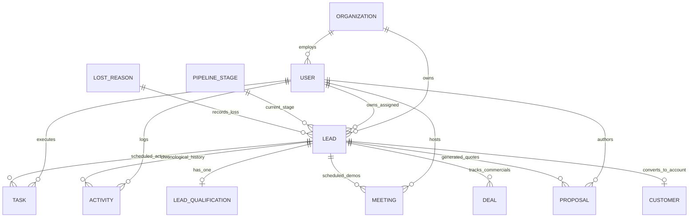

# Lead Architecture & Central Master Record Audit

**Date:** 2026-10-08  
**Scope:** Architectural Audit & Restructuring Blueprint for the **Leads Module as Central Sales Master Record**  
**Reference Document:** *CRM – Main Use Cases & MVP Requirements* / `docs/BUSINESS-RULES.md` / `docs/DATA-MODEL.md`  
**Audit Mode:** Strict Read-Only Technical Analysis  

---

## 1. Executive Summary & Core Architectural Principle

### 1.1 The Core Principle: Lead as the Central Master Sales Record
In a high-velocity B2B agency/service sales environment (DigiTechzo), the **Lead is not a disposable intake note** that gets abandoned after creation. The **Lead is the central master record** of the entire sales engagement journey:

```
Lead Ingestion (Meta / Google / Web Form / WhatsApp / Manual / Import)
  ↓
New Lead Ingestion & Deduplication
  ↓
Assignment (Owner Allocation & SLA Timer)
  ↓
First Contact & Touchpoints (Call / WhatsApp / Email / Timeline)
  ↓
BANT Qualification (Need, Budget, Authority, Timeline, Score)
  ↓
Scheduled Follow-ups & Tasks (Mandatory Next Action Enforcement)
  ↓
Meeting / Demo (Discovery, Product Demo, Technical Scoping)
  ↓
Proposal & Commercial Quotation (Draft, Revisions, Negotiations)
  ↓
Deal Finalization (Closed-Won / Closed-Lost Governance)
  ↓
Customer Handover (Account Delivery, Purchased Services, Retainers)
```

### 1.2 Current System Dilemma
Currently, the codebase exhibits **fragmentation across sub-systems**:
- **Pipeline/Deals** operate on a separate `Deal` model with its own `stageId`, while `Lead` only tracks a coarse `status` enum (`NEW`, `QUALIFIED`, `CONVERTED`, etc.).
- Downstream entities (`Deal`, `Task`, `Activity`, `Meeting`, `Proposal`, `Customer`) treat `leadId` as an **optional, nullable foreign key** (`leadId String?`).
- The frontend `LeadsPage.tsx` uses an ephemeral modal preview that displays contact info and a next action banner, but **lacks a full 360° lead dossier** showing linked deals, proposals, meetings, qualification history, and timeline.
- Commercial status can drift: a Deal can move across pipeline stages (e.g. from *Discovery* to *Proposal Sent* to *Negotiation*) without updating the master Lead's stage or visibility.

---

## 2. Current Lead Fields Audit & Classification

The `Lead` model in `apps/api/prisma/schema.prisma` currently contains **24 fields**:

| Field Name | Type | Current Nullability | Classification | Audit Findings & Rationale |
|---|---|---|---|---|
| `id` | `String` (UUID) | Required | **REQUIRED / KEEP IN LEAD** | Immutable Master Record Identifier across all CRM touchpoints. |
| `organizationId` | `String` (UUID) | Required | **REQUIRED / KEEP IN LEAD** | Multi-tenant tenant boundary isolation. |
| `ownerId` | `String` (UUID) | Required | **REQUIRED / KEEP IN LEAD** | Enforces Rule BR-OWN-01 (Mandatory Lead Ownership). Must always point to an active `User`. |
| `fullName` | `String` | Required | **REQUIRED / KEEP IN LEAD** | Primary prospect contact name. |
| `companyName` | `String?` | Optional | **OPTIONAL / KEEP IN LEAD** | Business/Account name. Nullable for B2C/individual inquiries. |
| `title` | `String?` | Optional | **OPTIONAL / KEEP IN LEAD** | Job title / designation (e.g., "Founder", "CTO", "Marketing Head"). |
| `phone` | `String` | Required | **REQUIRED / KEEP IN LEAD** | Primary normalized phone number (E.164 format) for telephony and WhatsApp. |
| `email` | `String?` | Optional | **OPTIONAL / KEEP IN LEAD** | Email address for email communication and deduplication. |
| `source` | `String` | Required | **REQUIRED / KEEP IN LEAD** | Immutable channel origin (`META_ADS`, `GOOGLE_ADS`, `WEBSITE_FORM`, `WHATSAPP`, `MANUAL`, `IMPORT`, `PHONE_INBOUND`). Rule BR-SRC-01. |
| `status` | `String` | Required (`NEW`) | **REQUIRED / KEEP IN LEAD** | Lifecycle stage: `NEW`, `CONTACTED`, `QUALIFIED`, `UNQUALIFIED`, `CONVERTED`, `LOST`. |
| `priority` | `String` | Required (`MEDIUM`) | **OPTIONAL / KEEP IN LEAD** | Operational urgency: `LOW`, `MEDIUM`, `HIGH`, `URGENT`. |
| `temperature` | `String?` | Optional | **OPTIONAL / KEEP IN LEAD** | Sales intent rating: `HOT`, `WARM`, `COLD`. |
| `leadScore` | `Int?` | Optional | **OPTIONAL / KEEP IN LEAD** | Algorithmic BANT score (0 to 100). |
| `serviceInterest` | `String` | Required | **REQUIRED / KEEP IN LEAD** | Primary requested service line (e.g. "Custom Web Application", "Performance Marketing"). |
| `unqualifiedReason` | `String?` | Optional | **OPTIONAL / KEEP IN LEAD** | Standardized unqualification code when `status = UNQUALIFIED` (Rule BR-QUAL-03). |
| `unqualifiedNotes` | `String?` | Optional | **OPTIONAL / KEEP IN LEAD** | Contextual notes detailing unqualification. |
| `lastActivityAt` | `DateTime` | Required (`now()`) | **REQUIRED / KEEP IN LEAD** | Drives inactivity alerts (Rule BR-INACT-01: 24h/48h alert timers). |
| `nextActionDueAt` | `DateTime?` | Optional | **DENORMALIZED SNAPSHOT / KEEP** | Indexed timestamp for high-speed BDE daily work queue queries (Rule BR-ACT-01). Authoritative record is in `Task`. |
| `nextActionType` | `String?` | Optional | **DENORMALIZED SNAPSHOT / KEEP** | Action type snapshot (`CALL`, `WHATSAPP`, `EMAIL`, `MEETING`, `PROPOSAL`). |
| `nextActionPurpose` | `String?` | Optional | **DENORMALIZED SNAPSHOT / KEEP** | Brief purpose description snapshot for the next scheduled follow-up. |
| `nextActionOwnerId` | `String?` | Optional | **DENORMALIZED SNAPSHOT / KEEP** | User ID assigned to the next action. |
| `deletedAt` | `DateTime?` | Optional | **OPTIONAL / KEEP IN LEAD** | Soft-deletion timestamp. |
| `createdAt` | `DateTime` | Required (`now()`) | **REQUIRED / KEEP IN LEAD** | Ingestion timestamp for attribution and velocity metrics. |
| `updatedAt` | `DateTime` | Required | **REQUIRED / KEEP IN LEAD** | Last modification timestamp. |

---

## 3. Recommended Missing Lead Fields (Required by Business Specification)

According to `docs/REQUIREMENTS.md` and `docs/DATA-MODEL.md`, the following attributes are currently **missing** from `Lead` and should be introduced in a future schema evolution:

| Proposed Field | Type | Purpose | Business Justification |
|---|---|---|---|
| `stageId` | `String?` (UUID) | FK -> `pipeline_stages.id` | Connects the Lead directly to the authoritative sales pipeline stage (`Qualification`, `Discovery`, `Proposal Sent`, `Negotiation`, `Closed Won`, `Closed Lost`). Eliminates stage drift. |
| `estimatedValue` | `Decimal?` (14,2) | Commercial deal value | Displays potential revenue directly on the lead master record without requiring a separate disjoint Deal navigation. |
| `campaignName` | `String?` | Marketing Campaign | Tracks ad campaign attribution (e.g. "Q4-SaaS-Performance-Campaign"). |
| `utmSource` | `String?` | UTM Tracking | Inbound web analytics parameter (`utm_source`). Immutable attribution. |
| `utmMedium` | `String?` | UTM Tracking | Inbound web analytics parameter (`utm_medium`). |
| `utmCampaign` | `String?` | UTM Tracking | Inbound web analytics parameter (`utm_campaign`). |
| `utmTerm` | `String?` | UTM Tracking | Inbound keyword search term (`utm_term`). |
| `utmContent` | `String?` | UTM Tracking | Inbound ad creative variant (`utm_content`). |
| `industry` | `String?` | Firmographic Taxonomy | Client business vertical (e.g. "FinTech", "EdTech", "Logistics", "Healthcare", "E-Commerce"). |
| `locationCity` | `String?` | Geographical Location | Prospect city / territory. |
| `locationCountry` | `String?` | Geographical Location | Country (Default: "India"). |
| `secondaryPhone` | `String?` | Contact Redundancy | Alternate contact / direct WhatsApp mobile number. |

---

## 4. Fields to Remove, Consolidate, or Relocate

| Field / Concept | Current Location | Problem | Recommended Action |
|---|---|---|---|
| **Status / Temperature Confusion** | Frontend `LeadsPage.tsx` | Legacy frontend treated `HOT`, `WARM`, `COLD` as `status` filter pills instead of Lifecycle states. | Standardize: `status` = Lifecycle (`NEW`, `CONTACTED`, `QUALIFIED`, `UNQUALIFIED`, `CONVERTED`, `LOST`); `temperature` = Priority Heat (`HOT`, `WARM`, `COLD`). |
| **Contact Duplication in Customer** | `Customer` model | `Customer` stores raw duplicate `contactName`, `phone`, `email` instead of referencing the master Lead contact identity. | Keep `Customer.leadId` as mandatory foreign key; treat Lead as the originating prospect master. |
| **Stage Isolation in Deal** | `Deal.stageId` | Sales stage exists only on Deal. Leads without deals have no pipeline stage; Leads with deals have detached stages. | Make `stageId` authoritative on `Lead` (or mirror `Lead.stageId` $\leftrightarrow$ `Deal.stageId`). |
| **Unlinked Entities** | `Task`, `Meeting`, `Activity`, `Proposal` | `leadId` is nullable across all tables, allowing orphan records with zero lead traceability. | Enforce that any sales task, activity, meeting, or proposal created in the CRM must reference a mandatory `leadId`. |

---

## 5. Central Lead Relationship Audit

| Relationship | Database Foreign Key | Mandatory vs Optional | Can Exist Without Lead? | Frontend Selection | Backend Integrity | Shown in Lead Detail? | Updates Lead Journey? |
|---|---|---|---|---|---|---|---|
| **Lead $\to$ Qualification** | `LeadQualification.leadId` | 1-to-1 (Unique FK) | **No** (Cascade on Lead) | In Lead Detail | Enforced in Prisma | **Partial** (Score only) | **Yes** (Computes `leadScore` & sets `status = QUALIFIED`) |
| **Lead $\to$ Pipeline / Deal** | `Deal.leadId` | 1-to-Many (`leadId String?`) | **Yes** (Orphan deals allowed) | Optional in Deal form | Loose association | **No** (Deals hidden in Lead view) | **Partial** (Only `markWon` updates Lead status to `CONVERTED`) |
| **Lead $\to$ Task** | `Task.leadId` | 1-to-Many (`leadId String?`) | **Yes** (General tasks allowed) | Optional in Task form | Synchronizes `nextAction*` snapshot | **No** (Only Next Action banner shown) | **Yes** (Task completion updates `Lead.lastActivityAt` & `Lead.nextAction`) |
| **Lead $\to$ Activity** | `Activity.leadId` | 1-to-Many (`leadId String?`) | **Yes** (Unlinked logs allowed) | Optional in Activity form | Updates `Lead.lastActivityAt` | **No** (Activity timeline missing in Lead view) | **Yes** (Updates `lastActivityAt`) |
| **Lead $\to$ Meeting** | `Meeting.leadId` | 1-to-Many (`leadId String?`) | **Yes** (Orphan meetings allowed) | Optional in Meeting form | Loose association | **No** (Meetings missing in Lead view) | **No** (Meeting creation/completion does not update Lead) |
| **Lead $\to$ Proposal** | `Proposal.leadId` | 1-to-Many (`leadId String?`) | **Yes** (Orphan proposals allowed) | Optional in Proposal form | Loose association | **No** (Proposals missing in Lead view) | **No** (Proposal accept/reject does not update Lead) |
| **Lead $\to$ Customer** | `Customer.leadId` | 1-to-Many (`leadId String?`) | **Yes** (Manual customers allowed) | Optional in Customer form | Loose association | **No** (Customer record missing in Lead view) | **No** (Customer creation does not link back to Lead) |

---

## 6. Pipeline & Sales Stage Architecture Recommendation

### 6.1 Clarification of Dimensions
To prevent status collisions and workflow ambiguity, the CRM must maintain **five distinct, non-conflicting dimensions**:

```
1. Lifecycle Status (Where is the lead in the macro journey?)
   → NEW → CONTACTED → QUALIFIED → UNQUALIFIED → CONVERTED (Won) → LOST

2. Pipeline Stage (Where is the commercial negotiation right now?)
   → Qualification (#1) → Discovery (#2) → Proposal Sent (#3) → Negotiation (#4) → Closed Won (#5) → Closed Lost (#6)

3. Temperature / Intent Rating (How hot is the deal?)
   → HOT (Urgent, High Budget, Direct Decision Maker)
   → WARM (Valid Need, 1-3 Month Timeline)
   → COLD (Exploratory, Long Horizon)

4. Task Priority (How quickly must the BDE act?)
   → URGENT (< 2 hours) → HIGH (Today) → MEDIUM (Normal) → LOW (Backlog)

5. Commercial Status (What is the contract state?)
   → DRAFT → SENT → NEGOTIATION → ACCEPTED → REJECTED
```

### 6.2 The Unified Stage Synchronization Rule
When a Lead or Deal advances:
- Advancing stage to **Qualification (#1)** $\implies$ `Lead.status = 'NEW'` or `'CONTACTED'`.
- BANT Qualification completed $\implies$ `Lead.status = 'QUALIFIED'`, Stage moves to **Discovery (#2)**.
- Proposal dispatched $\implies$ Stage automatically advances to **Proposal Sent (#3)**.
- Deal won $\implies$ Stage moves to **Closed Won (#5)**, `Lead.status = 'CONVERTED'`, trigger Customer record generation.
- Deal lost $\implies$ Stage moves to **Closed Lost (#6)**, `Lead.status = 'LOST'`, enforce mandatory `lostReasonId`.

---

## 7. The 360-Degree Lead Master Dossier Blueprint

The central Lead Detail page must serve as the **single source of truth for the entire lead journey**. It must incorporate 15 cohesive sections:

```
+---------------------------------------------------------------------------------------------------+
| LEAD 360° MASTER DOSSIER — [ Kaniga • CTO at DigiTechzo Media ]                                   |
| Status: [QUALIFIED]   Stage: [PROPOSAL SENT (#3)]   Score: [85/100 - HOT]   Owner: [Neha Kulkarni]|
+---------------------------------------------------------------------------------------------------+
| 1. SUMMARY HEADER                                                                                 |
|    - Full Name, Title, Company Name, Industry ("FinTech"), Location ("Bengaluru, India")          |
|    - BANT Lead Score (85/100), Temperature Badge (HOT), Inactivity Alert (Last active 2h ago)    |
|    - Quick Actions: [Log Call] [Send WhatsApp] [Send Email] [Schedule Meeting] [Create Proposal]  |
+---------------------------------------------------------------------------------------------------+
| 2. SCHEDULED NEXT ACTION BANNER (Rule BR-ACT-01)                                                  |
|    - Scheduled Follow-up Call • Today at 3:30 PM • Purpose: "Review commercial proposal terms"   |
|    - Actions: [Complete Action & Log Outcome] [Reschedule with Reason]                            |
+--------------------------------------------------+------------------------------------------------+
| LEFT COLUMN (Core Data & Journey)                | RIGHT COLUMN (Activity Stream & Transactions)  |
+--------------------------------------------------+------------------------------------------------+
| 3. CONTACT & ATTRIBUTION INFORMATION             | 8. COMPLETE ACTIVITY TIMELINE (Chronological)  |
|    - Phone: +91 81222 89508 (Primary Mobile)     |    - [10:30 AM] Proposal v2 Sent (Email)      |
|    - Email: kaniga@digitechzo.com                |    - [Yesterday] Demo Completed (Meet URL)     |
|    - Source: META_ADS (Facebook Inbound)         |    - [2 Days Ago] WhatsApp Chat: Scope agreed  |
|    - Campaign: "Q4-Enterprise-SaaS"              |    - [3 Days Ago] BANT Qualification Saved    |
|    - UTM: source=fb, medium=cpc, campaign=q4     |    - [Oct 05] Inbound Lead Created via Ad     |
+--------------------------------------------------+------------------------------------------------+
| 4. BANT QUALIFICATION DETAILS (Rule BR-QUAL-01)  | 9. TASKS & FOLLOW-UP QUEUE                     |
|    - Need / Problem Statement: Full custom CRM   |    - [ ] Call CFO regarding payment terms      |
|    - Budget Amount: ₹12,00,000 (CONFIRMED)       |    - [✓] Prepare proposal v2 deck              |
|    - Authority: DECISION_MAKER (CTO)             |                                                |
|    - Timeline: IMMEDIATE_2WEEKS                  +------------------------------------------------+
|    - Urgency: 5 / 5                              | 10. MEETINGS & DEMOS                           |
|    - Qualified by: DigiTechzo Administrator      |    - Discovery Call (Completed • Oct 06)       |
+--------------------------------------------------+    - Technical Demo (Completed • Oct 07)        |
| 5. COMMERCIAL PIPELINE & DEALS                   +------------------------------------------------+
|    - Active Deal: "Enterprise CRM Implementation"| 11. PROPOSALS & QUOTATIONS                     |
|    - Deal Value: ₹12,00,000 INR                  |    - Quote #PROP-2026-004 (v2 • Sent • ₹12L)   |
|    - Stage: Proposal Sent (Win Prob: 60%)        |    - Quote #PROP-2026-001 (v1 • Superseded)    |
|    - Expected Close: Oct 25, 2026                +------------------------------------------------+
+--------------------------------------------------+ 12. WON CUSTOMER PROFILE (If Converted)       |
| 6. SERVICE LINE & SPECIFICATIONS                 |    - Customer ID: CUST-8821                    |
|    - Custom Web Application Development          |    - Account Manager: Neha Kulkarni            |
|    - Delivery SLA: 60 Days                       |    - Contract: Active AMC (Starts Nov 01)      |
+--------------------------------------------------+------------------------------------------------+
| 7. INTERNAL COLLABORATION NOTES                                                                   |
|    - Rep Notes, Technical feasibility comments, Special commercial discount approvals             |
+---------------------------------------------------------------------------------------------------+
```

---

## 8. Database Cleanliness & Relationship Consolidation Audit

### 8.1 Model Relationship Assessment



### 8.2 Redundant Columns & Inefficiencies Identified

1. **`Customer` Model:**
   - Redundant fields: `companyName`, `contactName`, `phone`, `email`.
   - *Recommendation:* Keep `leadId` as a unique mandatory reference; make `Customer` represent the account contract, billing details (GST/Tax ID, Billing Address, Payment Terms), and delivery handoff without disconnecting from the originating Lead.
2. **`Deal` Model:**
   - In single-opportunity agency workflows, `Deal` is frequently a 1:1 commercial wrapper around `Lead`.
   - *Recommendation:* Keep `Deal` linked with mandatory `leadId`; mirror `Lead.stageId` $\leftrightarrow$ `Deal.stageId` to prevent out-of-sync stages.
3. **`Task` / `Meeting` / `Proposal` / `Activity`:**
   - Currently allow `leadId = NULL`.
   - *Recommendation:* Enforce that all customer-facing sales tasks, meetings, and proposals must have a mandatory `leadId`.

---

## 9. Recommended Implementation & Restructuring Sequence

To achieve the unified Master Lead architecture safely without database disruption:

### Phase 1: Frontend Lead 360° View Integration (Non-Breaking)
- Create a dedicated route `/leads/:id` with a full-page tabbed 360° Lead Master Dossier.
- Connect existing live sub-queries (`crmApi.getLead(id)`, `crmApi.getTasks({ leadId })`, `crmApi.getActivities({ leadId })`, `crmApi.getMeetings({ leadId })`, `crmApi.getProposals({ leadId })`, `crmApi.getDeals({ leadId })`).
- Surface BANT qualification details directly on the Lead screen.

### Phase 2: Stage & Status Synchronization in Backend Services
- Ensure that moving a Deal in Pipeline automatically updates `Lead.status` and `Lead.stageId`.
- Ensure that dispatching a Proposal advances the stage to *Proposal Sent*.
- Ensure that marking a Deal Won transitions `Lead.status = 'CONVERTED'` and triggers Customer creation.

### Phase 3: Enhanced Lead Schema Evolution (Additive Only)
- Add marketing attribution fields (`campaignName`, `utmSource`, `utmMedium`, `utmCampaign`, `utmTerm`, `utmContent`).
- Add firmographic fields (`industry`, `locationCity`, `locationCountry`, `secondaryPhone`).
- Add direct `stageId` foreign key referencing `PipelineStage`.

---

## 10. Summary Comparison Matrix

| Area | Current Implementation | Proposed Master Lead Model | Business Rationale | Risk Level |
|---|---|---|---|---|
| **Master Entity** | Fragmented across Leads, Deals, and Customers. | **Lead is the Master Record** from capture to won customer. | Guarantees complete end-to-end auditability and prevents leads from being lost. | Low |
| **Pipeline Stage** | Stored only in `Deal.stageId`. Leads have no stage. | `Lead.stageId` synchronized with `Deal.stageId`. | Single authoritative pipeline stage visible everywhere. | Low |
| **Lead Detail View** | Compact preview modal with contact info and next action. | **Full 360° Dossier** with BANT, deals, proposals, meetings, and timeline. | Empowers sales reps with complete context on a single screen. | Zero |
| **Follow-up Next Action** | Denormalized snapshot on `Lead` synced by `TasksService`. | **Retained & Strengthened**; pinned overdue alerts on dashboard. | Enforces Rule BR-ACT-01 (Mandatory next action). | Zero |
| **Downstream Linkage** | `leadId` optional/nullable in Task, Meeting, Proposal, Customer. | **`leadId` mandatory** for all sales transactions. | Eliminates orphan data and preserves lead traceability. | Low |
| **Attribution Data** | Only coarse `source` string. No UTM or campaign tracking. | Added `campaignName`, `utmSource`, `utmMedium`, `utmCampaign`. | Enables marketing ROI and campaign conversion reporting. | Zero (Additive) |
| **BANT Qualification** | Stored in `LeadQualification` table; partial UI visibility. | Fully displayed and editable in Lead 360° view. | Enforces Rule BR-QUAL-01 before pipeline advancement. | Zero |
