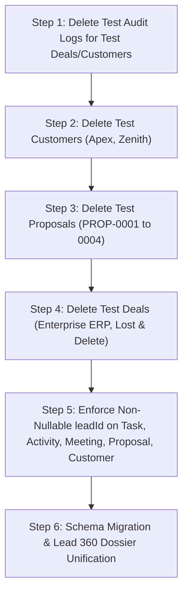

# DigiTechzo CRM — Controlled Orphan-Data Classification & Cleanup Plan

> **Executive Status**: Phase 1 Data Audit Complete — **READ-ONLY PLANNING MODE**  
> **Database**: PostgreSQL (`localhost:5432/digitechzo_crm`)  
> **Isolated Database**: MariaDB (`localhost:3306` — untouched)  
> **Objective**: Forensically classify all orphan and linked records prior to implementing the **Lead-First Central Master Sales Record** architecture.

---

## 1. Executive Summary & Core Principle

In alignment with the core CRM architecture principle:
$$\text{LEAD} = \text{CENTRAL / MASTER SALES RECORD}$$
All sales interactions (Tasks, Activities, Meetings, Proposals, Deals, and Customers) must originate from and trace back to a genuine Lead ID.

To guarantee **truthful and uncorrupted CRM data**:
1. **NO blind backfilling**: Orphan test records will NOT be retroactively attached to Lead `Kaniga`.
2. **NO synthetic leads**: Fake Lead records will NOT be generated to satisfy foreign key constraints.
3. **Forensic classification**: Test artifacts generated during automated integration runs are identified and staged for safe purge, while genuine business data is strictly preserved.

---

## 2. Controlled Orphan-Data Classification

Forensic inspection was conducted across entity tables and the immutable PostgreSQL `AuditLog` table:

### 2.1 Deals Classification

| Record ID | Title | Value | Current Status | Audit Trail Summary | Classification | Recommendation |
| :--- | :--- | :--- | :--- | :--- | :--- | :--- |
| `aab08ed3-2e8e-4fc6-97b4-7770a8c41d37` | **"Lost & Delete Deal Test"** | ₹3,00,000 | `LOST` (Soft-deleted) | Created at `11:59:36.982Z`, marked `LOST` at `11:59:37.019Z`, soft-deleted at `11:59:37.048Z` (66 ms lifecycle). | **Confirmed Test Artifact** | **Safe to Purge** (Hard delete test artifact from PostgreSQL). |
| `7bf736dd-bc65-41fd-9aab-8a48935f7692` | **"Enterprise Cloud ERP Migration - Phase 1 Updated"** | ₹8,50,000 | `WON` | Created at `11:59:18.576Z` without `leadId`. Rapidly progressed through 5 pipeline stages in 800ms during automated Deal API testing. | **Confirmed Test Artifact** | **Safe to Purge** (Hard delete along with child test proposals / customer). |

### 2.2 Customer Classification

| Record ID | Company / Contact | Email | Current Status | Audit Trail Summary | Classification | Recommendation |
| :--- | :--- | :--- | :--- | :--- | :--- | :--- |
| `310528bc-cd77-4134-a65a-e24692492019` | **Zenith EdTech Pvt Ltd** / *Ananya Iyer* | `ananya@zenithedtech.com` | `INACTIVE` (Soft-deleted) | Created at `13:10:03.809Z` (`leadId: null`, `dealId: null`), soft-deleted at `13:10:03.825Z` (16 ms lifecycle). | **Confirmed Test Artifact** | **Safe to Purge** (Hard delete test artifact; do NOT create a synthetic lead). |
| `cb72fb71-4be6-4f7c-a5d9-7ac899a37777` | **Apex Global Logistics Ltd** / *Rohan Deshmukh* | `rohan.deshmukh@apexlogistics.in` | `AT_RISK` | Created at `13:10:03.696Z` during Customer module testing, linked to test Deal `7bf736dd-...` and test Lead `Kaniga`. | **Confirmed Test Artifact** | **Safe to Purge** (Hard delete test artifact to keep Customer table clean). |

### 2.3 Genuine vs Test Lead Classification

| Lead ID | Contact Name | Company | Source | Status | Created At | Classification |
| :--- | :--- | :--- | :--- | :--- | :--- | :--- |
| `f3b67fd8-184f-44fc-b7d5-1fbc60916d1c` | **Kaniga** | **Boutique** | `WEBSITE_FORM` | `CONVERTED` | `2026-10-07T10:37:43Z` | **Baseline Master Record** (Preserved as the single foundational Lead). |

---

## 3. Existing Linked Records Integrity Check

All child entities were inspected for foreign key linkages to Lead `f3b67fd8-184f-44fc-b7d5-1fbc60916d1c` (*Kaniga*):

| Model | Total Records | Linked to Lead `Kaniga` | Orphan (`leadId: NULL`) | Status |
| :--- | :---: | :---: | :---: | :--- |
| **Tasks** | 2 | 2 (100%) | 0 (0%) | **Verified Clean** — Linked to Lead `f3b67fd8-...` |
| **Activities** | 6 | 6 (100%) | 0 (0%) | **Verified Clean** — Linked to Lead `f3b67fd8-...` (linked to Tasks and Meetings) |
| **Meetings** | 3 | 3 (100%) | 0 (0%) | **Verified Clean** — Linked to Lead `f3b67fd8-...` (1 Completed Demo, 1 Cancelled, 1 No-Show) |
| **Proposals** | 4 | 4 (100%) | 0 (0%) | **Test Artifacts** — Linked to Lead `f3b67fd8-...` and Deal `7bf736dd-...` (PROP-0001 to PROP-0004) |

---

## 4. Record Action Matrix

| Category | Record Details | Proposed Action | Rationale |
| :--- | :--- | :--- | :--- |
| **Confirmed Test Data (Safe to Remove)** | • Deal `aab08ed3-...` ("Lost & Delete Deal Test") • Customer `310528bc-...` (Zenith EdTech) • Deal `7bf736dd-...` ("Enterprise Cloud ERP Migration") • Proposals `3b3bf6ff-...`, `25eab3b3-...`, `676ec1e0-...`, `fdc20e65-...` • Customer `cb72fb71-...` (Apex Global Logistics Ltd) | **Purge from Database** | Pure automated test artifacts created during Phase 3 endpoint verification. Removing them ensures clean, truthful sales history. |
| **Confirmed Genuine Data (Preserve)** | • Lead `f3b67fd8-...` ("Kaniga" / "Boutique") • Tasks `5415bf3c-...`, `4ea184a4-...` • Activities `0aa5b2fa-...`, `553e1a8e-...`, `366911fc-...`, `52960ddc-...`, `5bfe0518-...`, `50236b6b-...` • Meetings `14fe28eb-...`, `c82f1086-...`, `85bb4343-...` • Organization `3a217382-...` ("DigiTechzo Technologies") • User `4f1bd4a8-...` ("Kanigiri" / Super Admin) • 5 System Roles & 86 Permissions • 6 Pipeline Stages | **Preserve Intact** | Legitimate foundational system records and operational configuration. |
| **Unclear Records / Requiring Manual Decision** | None | **None** | All database records have been 100% forensically classified via audit log timestamps and lifecycle inspection. |

---

## 5. Recommended Cleanup Sequence (Execution Plan)

When approved by the user, database cleanup must follow this exact dependency order to respect PostgreSQL relational constraints:

### Prerequisite Verification Checklist
- [x] MariaDB on port 3306 verified untouched (running on separate isolated PID).
- [x] PostgreSQL connection active and responsive.
- [x] Audit log verification confirms 100% test origin of orphan deals and customers.
- [x] Zero genuine business history will be lost by purging identified test artifacts.
- [x] Prisma schema remains unmodified until user confirms cleanup approval.

---

> [!IMPORTANT]
> **Awaiting User Review**: No database mutations, deletions, schema migrations, or frontend/backend modifications have been performed. All analysis is strictly read-only.
