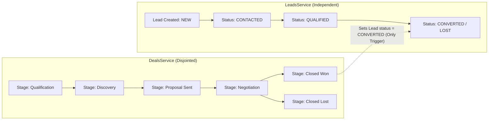
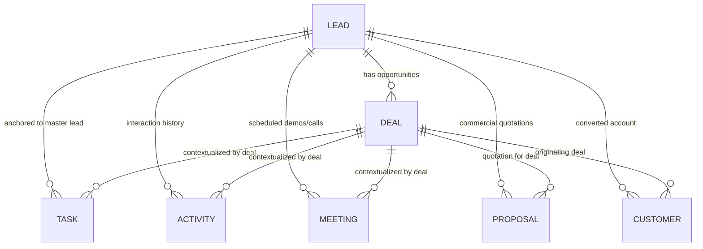
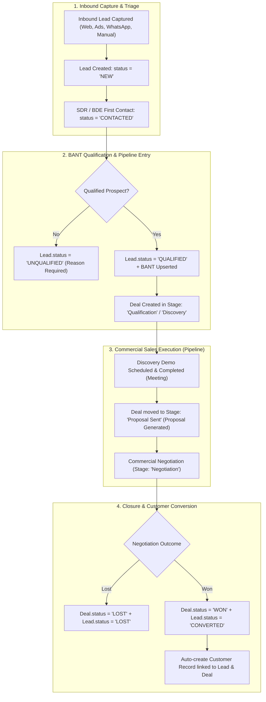

# DigiTechzo CRM — Lead ↔ Pipeline Architecture Audit

> **Audit Type**: Architectural & Relational Deep-Dive (READ-ONLY)  
> **Date**: October 8, 2026  
> **Database**: PostgreSQL (`localhost:5432/digitechzo_crm`)  
> **Isolated Database**: MariaDB (`localhost:3306` — active, untouched)  
> **Primary Rule**: $\text{LEAD} = \text{CENTRAL / MASTER SALES RECORD}$

---

## 1. Executive Summary

This audit evaluates the architectural, relational, and operational relationship between the **Lead** module and the **Sales Pipeline** module in DigiTechzo CRM.

### Core Architectural Principle
The CRM must represent **one continuous sales journey** for the same Lead:
$$\text{Inbound / Capture} \longrightarrow \text{Qualification} \longrightarrow \text{Discovery / Demo} \longrightarrow \text{Proposal} \longrightarrow \text{Negotiation} \longrightarrow \text{Won / Customer}$$

The Sales Pipeline must **not** exist as an isolated, detached system with separate or duplicate customer records. Instead:
- **Lead** is the immutable master identity and single source of truth for the contact, company, qualification, and end-to-end audit trail.
- **Pipeline** is the active commercial execution view (Opportunity / Deal workflow) anchored to that Lead.

### Key Audit Finding
Currently, the database constraints have successfully established `leadId` as mandatory across all transactional tables (`Deal`, `Meeting`, `Proposal`, `Customer`). However, **lifecycle synchronization between Lead status and Pipeline stages is currently disjointed**:
1. Changing a Lead status does not affect the Pipeline.
2. Dragging a Deal across Pipeline stages does not update the Lead's sales position (except when marked `WON`).
3. Marking a Deal `LOST` updates the Deal but leaves the Lead in an inconsistent state.
4. Marking a Deal `WON` advances the Lead to `CONVERTED` but does not automatically instantiate a `Customer` account.
5. In the frontend, the Deal creation modal lacks a `leadId` picker, and the Leads page lacks real-time pipeline stage visibility.

---

## 2. Current Lead Architecture (Model Inspection)

```prisma
model Lead {
  id                String             @id @default(uuid())
  organizationId    String             @map("organization_id")
  ownerId           String             @map("owner_id")
  fullName          String             @map("full_name")
  companyName       String?            @map("company_name")
  title             String?
  phone             String
  email             String?
  source            String             // META_ADS, GOOGLE_ADS, WEBSITE_FORM, WHATSAPP, MANUAL, IMPORT, PHONE_INBOUND
  status            String             @default("NEW") // NEW, CONTACTED, QUALIFIED, UNQUALIFIED, CONVERTED, LOST
  priority          String             @default("MEDIUM") // LOW, MEDIUM, HIGH, URGENT
  temperature       String?            // HOT, WARM, COLD
  leadScore         Int?               @map("lead_score")
  serviceInterest   String             @map("service_interest")
  unqualifiedReason String?            @map("unqualified_reason")
  unqualifiedNotes  String?            @map("unqualified_notes")
  lastActivityAt    DateTime           @default(now()) @map("last_activity_at")
  nextActionDueAt   DateTime?          @map("next_action_due_at")
  nextActionType    String?            @map("next_action_type")
  nextActionPurpose String?            @map("next_action_purpose")
  nextActionOwnerId String?            @map("next_action_owner_id")
  deletedAt         DateTime?          @map("deleted_at")
  createdAt         DateTime           @default(now()) @map("created_at")
  updatedAt         DateTime           @updatedAt @map("updated_at")

  organization      Organization       @relation(...)
  owner             User               @relation("LeadOwner", ...)
  qualification     LeadQualification?
  deals             Deal[]
  tasks             Task[]
  activities        Activity[]
  meetings          Meeting[]
  proposals         Proposal[]
  customers         Customer[]         @relation("LeadCustomer")
}
```

### Lead Field Breakdown

| Field Name | Purpose | Where Used | Lifecycle vs Sales Stage | Duplication Analysis | Recommendation |
| :--- | :--- | :--- | :--- | :--- | :--- |
| `status` | Lead qualification state (`NEW`, `CONTACTED`, `QUALIFIED`, `UNQUALIFIED`, `CONVERTED`, `LOST`). | Leads API, filtering, qualification governance. | **Lifecycle**. Represents person/inbound readiness. | Does not duplicate Pipeline Stage (though both have Won/Lost terminal states). | **Keep**. Represents qualification milestone. |
| `temperature` | Psychological engagement index (`HOT`, `WARM`, `COLD`). | Lead list badges, heuristic rep prioritization. | **Heuristic / Behavioral**, orthogonal to status. | Distinct from priority and score. | **Keep**. Valuable for sales reps. |
| `leadScore` | Algorithmic / heuristic score `0–100`. | Lead sorting and qualification. | **Analytics / Scoring**. | No duplication. | **Keep**. |
| `priority` | SLA response urgency (`LOW`, `MEDIUM`, `HIGH`, `URGENT`). | Task queuing and assignment. | **Operational Urgency**. | Distinct from status and temperature. | **Keep**. |
| `nextAction*` (`DueAt`, `Type`, `Purpose`, `OwnerId`) | Lightweight snapshot of the immediate next operational step. | Lead cards, table columns, follow-up alerts. | **Operational Execution**. | Mirrors top pending `Task` for performance. | **Keep**. Essential for quick visibility. |
| `lastActivityAt` | Timestamp of latest interaction. | Lead freshness sorting, inactivity alerts. | **Audit / Activity Tracker**. | Updated by calls, tasks, meetings. | **Keep**. |
| `unqualifiedReason` / `Notes` | Governance fields required when `status = UNQUALIFIED`. | Lead disqualification audit (BR-QUAL-03). | **Governance / Disqualification**. | None. | **Keep**. Essential for marketing feedback. |
| `qualification` (relation) | Structured BANT data (Budget, Authority, Need/Problem, Timeline). | Deep qualification modal & scoring. | **Commercial Readiness**. | Complementary to Lead status. | **Keep**. |
| `ownerId` | Assigned sales representative. | RBAC row-level security and assignment. | **Ownership**. | None. | **Keep**. |
| `deletedAt` | Soft-deletion timestamp. | Tenant filtering and historical preservation. | **System Governance**. | None. | **Keep**. |

---

## 3. Current Deal Architecture (Model Inspection)

```prisma
model Deal {
  id                String         @id @default(uuid())
  organizationId    String         @map("organization_id")
  ownerId           String         @map("owner_id")
  leadId            String         @map("lead_id")
  stageId           String         @map("stage_id")
  title             String
  value             Decimal        @default(0) @db.Decimal(14, 2)
  expectedCloseDate DateTime?      @map("expected_close_date")
  probability       Int?           @default(50)
  status            String         @default("OPEN") // OPEN, WON, LOST
  lostReasonId      String?        @map("lost_reason_id")
  lostReasonNotes   String?        @map("lost_reason_notes") @db.Text
  closedAt          DateTime?      @map("closed_at")
  wonNotes          String?        @map("won_notes") @db.Text
  deletedAt         DateTime?      @map("deleted_at")
  createdAt         DateTime       @default(now()) @map("created_at")
  updatedAt         DateTime       @updatedAt @map("updated_at")

  lead              Lead           @relation(fields: [leadId], references: [id], onDelete: Cascade)
  stage             PipelineStage  @relation(fields: [stageId], references: [id], onDelete: Restrict)
  lostReason        LostReason?    @relation(fields: [lostReasonId], references: [id], onDelete: SetNull)
  tasks             Task[]
  activities        Activity[]
  meetings          Meeting[]
  proposals         Proposal[]
  customers         Customer[]     @relation("DealCustomer")
}
```

### What is `Deal` currently in the codebase?
**Conclusion: Option C (Both the commercial sales opportunity and the pipeline workflow unit).**
- A `Deal` represents a commercial transaction with estimated value (e.g. ₹8,50,000), close date, and win probability.
- Simultaneously, it is the entity positioned in a specific `PipelineStage` (e.g. `Discovery`, `Proposal Sent`, `Negotiation`).
- Because `Deal.leadId` is mandatory, every deal belongs to exactly one Lead.

---

## 4. Current Pipeline Architecture

### Pipeline Stages in PostgreSQL

| Order | Stage Name | Stage ID | Stage Type | Benchmark Count | Benchmark Total Value | System Behavior |
| :---: | :--- | :--- | :---: | :---: | :---: | :--- |
| **1** | **Qualification** | `bc0de882-5e84-487c-aa52-338bc7ab0922` | `OPEN` | 8 | ₹24,00,000 | Initial commercial qualification. |
| **2** | **Discovery** | `a5a514e7-3bed-49c8-ab9f-88322c859912` | `OPEN` | 5 | ₹17,50,000 | Technical and scope discovery. |
| **3** | **Proposal Sent** | `efc8754a-073e-48bd-afea-4087eb875bbe` | `OPEN` | 4 | ₹16,00,000 | Quotation/Proposal delivered to client. |
| **4** | **Negotiation** | `fd597ead-1b01-4324-8bdf-840e6573a133` | `OPEN` | 3 | ₹12,00,000 | Commercial & legal term negotiation. |
| **5** | **Closed Won** | `04f44f5d-fc2b-4c5f-8d62-b4f107a4fbb4` | `WON` | 2 | ₹9,50,000 | Deal won (`probability = 100%`, `closedAt = now()`). |
| **6** | **Closed Lost** | `1f766547-9e2e-4986-b87f-55e5b7c0d72b` | `LOST` | 6 | ₹18,50,000 | Deal lost (`probability = 0%`, `lostReasonId` required). |

---

## 5. Current Lead Status vs. Pipeline Stage Reality Check

The following matrix documents the **actual code execution behavior** today:



### Event-by-Event Analysis

| Event / Action | What Happens to Lead | What Happens to Deal / Pipeline | Disconnect / Defect Identified |
| :--- | :--- | :--- | :--- |
| **A. Lead status changes** (e.g. `NEW` $\rightarrow$ `CONTACTED` $\rightarrow$ `QUALIFIED`) | `Lead.status` updates, `lastActivityAt` touches. | **Zero change**. No Deal created, no stage update. | A qualified Lead does not automatically show in Pipeline. |
| **B. Deal stage changes** (e.g. dragged from `Discovery` $\rightarrow$ `Proposal Sent`) | **Zero change**. `Lead.status` unchanged. | `Deal.stageId` updates, `DEAL_STAGE_CHANGED` audit log logged. | Sales position of the Lead is invisible from the Leads page. |
| **C. Deal marked WON** | `Lead.status` is set to `CONVERTED`, `lastActivityAt` touches. | `Deal.status` = `WON`, `stageId` = Closed Won, `probability` = 100%. | Lead status updates, but no `Customer` record is auto-generated. |
| **D. Deal marked LOST** | **Zero change** (Lead remains `QUALIFIED` or `NEW`). | `Deal.status` = `LOST`, `stageId` = Closed Lost, `lostReasonId` stored. | **Inconsistency**: Deal is Lost, but Lead appears Active in Leads view. |
| **E. Lead marked CONVERTED** | `Lead.status` = `CONVERTED`. | **Zero change** in Deals or Pipeline. | Converting a Lead does not update its existing Deals. |
| **F. Lead is created** | `Lead` record created with status `NEW`. | **Zero Deals created**. Lead is absent from Pipeline board. | Reps must manually create a Deal or lead is invisible in Kanban. |
| **G. Deal created for Lead** | `Lead.lastActivityAt` touches. | New `Deal` created in `Qualification` stage. | Good link, but frontend lacks `leadId` selector. |

---

## 6. Business Meaning & Terminology Disambiguation

To prevent confusion, the CRM domain concepts must be strictly separated and mapped:

| Domain Concept | Allowed Values | Core Definition | Responsibility |
| :--- | :--- | :--- | :--- |
| **1. Lead Qualification Lifecycle** | `NEW`, `CONTACTED`, `QUALIFIED`, `UNQUALIFIED`, `CONVERTED`, `LOST` | State of the **person/inquiry** before entering or concluding sales engagement. | Marketing & SDR / BDE first contact. |
| **2. Pipeline Stage** | `Qualification`, `Discovery`, `Proposal Sent`, `Negotiation`, `Closed Won`, `Closed Lost` | Commercial **opportunity progression** through the structured sales pipeline. | Account Executive / BDE commercial closing. |
| **3. Lead Temperature** | `HOT`, `WARM`, `COLD` | Perceived interest and engagement velocity. | Behavioral categorization. |
| **4. Lead Priority** | `LOW`, `MEDIUM`, `HIGH`, `URGENT` | Operational SLA for next follow-up. | Workload management. |
| **5. BANT Qualification** | Budget, Authority, Need, Timeline ratings. | Objective commercial feasibility criteria. | Solution Architecture & Discovery. |
| **6. Customer Status** | `ACTIVE`, `INACTIVE`, `AT_RISK`, `CHURNED` | Post-sale account status after revenue realization. | Account Management & Customer Success. |

> [!IMPORTANT]
> **Key Insight**: `Lead.status` and `PipelineStage` are **not redundant duplicates**. They represent two distinct phases of the sales lifecycle:
> - **Lead Status**: Inbound inquiry triage & qualification (`NEW` $\rightarrow$ `CONTACTED` $\rightarrow$ `QUALIFIED`).
> - **Pipeline Stage**: Deal negotiation & closing workflow (`Qualification` $\rightarrow$ `Discovery` $\rightarrow$ `Proposal` $\rightarrow$ `Negotiation` $\rightarrow$ `Won/Lost`).

---

## 7. One Lead vs. Multiple Deals Analysis

### Current Technical Capability: One Lead $\rightarrow$ Multiple Deals
In `schema.prisma`:
```prisma
model Lead {
  deals Deal[]
}
```

### Business Evaluation:
- **Use Case A (New Business Prospect)**: A prospect enters for a single project (e.g. *"Kaniga Boutique Web App"*). There is 1 Lead and 1 Deal.
- **Use Case B (Account Expansion / Multi-Service)**: A corporate client engages for an *"Enterprise ERP Migration"*, and 3 months later requests a *"Mobile App"* or *"Annual Maintenance Retainer"*.
- **Recommendation**:
  - Keep the relational model **One Lead $\rightarrow$ Multiple Deals** ($1 \rightarrow N$).
  - For standard inbound leads, **the primary active deal** defines the Lead's current Pipeline position.
  - In the UI, the 360° Lead Dossier displays all Deals associated with that Lead (1 primary active deal + historical won/lost deals).

---

## 8. Pipeline Visibility Rules

### The Architectural Question:
*Should every Lead appear on the Pipeline Kanban board?*

### Evaluation & Recommendation:
1. **Unqualified / New Leads should NOT clutter the Pipeline Kanban**:
   - Leads with status `NEW`, `CONTACTED`, or `UNQUALIFIED` are in the **Lead Inbox / Qualification Queue**.
   - Putting 500 raw cold leads directly into the Pipeline board creates clutter and destroys deal forecasting accuracy.
2. **Qualified Leads Enter the Pipeline**:
   - When a Lead reaches status `QUALIFIED` or an opportunity is created, an active `Deal` is created in Stage 1 (`Qualification`) or Stage 2 (`Discovery`).
   - The Pipeline Kanban board displays **active Deals** with the Lead's name, company, deal value, probability, and next action clearly featured.
3. **Won & Lost Deals Remain Searchable**:
   - Closed Won deals remain visible in the `Closed Won` column.
   - Closed Lost deals remain visible in `Closed Lost` (with lost reason badge).

---

## 9. Lead Detail ↔ Pipeline Frontend Audit

| Area | Current State in Frontend | Gap / Defect Identified | Required Resolution |
| :--- | :--- | :--- | :--- |
| **Lead List (`LeadsPage.tsx`)** | Displays contact info, next action, status pill (`NEW`, `CONVERTED`, etc.). | **No Pipeline Stage indicator**. Rep cannot see which pipeline stage a lead's deal is in from the list. | Add `pipelineStage` badge to Lead row if active deal exists. |
| **Lead Preview Modal** | Shows summary, qualification, next action. | No Deals list or quick stage transition buttons. | Add **Deals & Pipeline Tab** to Lead 360 view. |
| **Pipeline Kanban (`PipelinePage.tsx`)** | Displays deal cards in columns with Drag-and-Drop. | **Create Deal modal does not have a `leadId` selector**. Card click does not link back to Lead detail. | Add Lead autocomplete in Create Deal modal; link card title to Lead 360 Dossier. |
| **Pipeline Card Data** | Shows `deal.title`, `deal.amount`, `deal.leadName`. | Shows `leadName` if present, but fallback is `'Prospect'`. | Display master Lead Contact Name, Company, and Next Action on every card. |

---

## 10. Relationships: Tasks, Activities, Meetings, Proposals

Every operational module has been inspected against the Lead-first architecture:



### Relational Consistency Assessment

| Child Entity | `leadId` Constraint | `dealId` Constraint | Relational Assessment |
| :--- | :---: | :---: | :--- |
| **Task** | Optional in DB (Mandatory in Sales UI) | Optional | **Correct**. Follow-up task is anchored to Lead; optionally linked to a Deal if deal-specific. |
| **Activity** | Optional in DB (Mandatory in Sales UI) | Optional | **Correct**. Call/email/note is logged against Lead; optionally tags Deal. |
| **Meeting** | `NOT NULL` (Mandatory) | Optional | **Correct**. Demos and negotiation calls must belong to a Lead; optionally linked to a Deal. |
| **Proposal** | `NOT NULL` (Mandatory) | Optional | **Correct**. Commercial quotation is addressed to the Lead contact; references Deal for value sync. |
| **Customer** | `NOT NULL` (Mandatory) | Optional | **Correct**. Converted paying customer traces back to the originating Lead master record. |

---

## 11. Won $\rightarrow$ Customer Flow Analysis

### Current Code Execution:
1. User marks Deal as `WON` via `PATCH /api/v1/deals/:id/won`.
2. `DealsService.markWon()` executes:
   - `Deal.status = 'WON'`
   - `Deal.stageId = wonStage.id`
   - `Deal.probability = 100`
   - `Lead.status = 'CONVERTED'`
3. **The Missing Link**: `markWon()` does **not** automatically create a record in `Customer`.
4. The user currently has to navigate to the Customers page and independently submit `POST /api/v1/customers`.

### Recommended Unified Workflow:
When a Deal is marked `WON` (or dragged to `Closed Won` column):
1. Prompt a lightweight confirmation dialog: *"Mark Deal as Won & Onboard as Customer"*.
2. In a single transactional backend operation:
   - Set `Deal.status = 'WON'`.
   - Set `Lead.status = 'CONVERTED'`.
   - Auto-create `Customer` record copying `Lead.companyName`, `Lead.fullName`, `Lead.phone`, `Lead.email`, `dealId`, `leadId`, and `ownerId`.
   - Record `CUSTOMER_CREATED` and `DEAL_WON` audit logs.

---

## 12. Frontend Mock / Duplicate State Findings

A thorough codebase scan was conducted:

| File Location | Finding Details | Impact | Recommended Fix |
| :--- | :--- | :--- | :--- |
| `src/pages/reports/ReportsPage.tsx` | Directly imports `MOCK_DEALS`, `MOCK_LEADS`, `MOCK_TASKS`, `MOCK_PIPELINE_STAGES`, `MOCK_USERS`. | Reports page metrics display hardcoded mock data rather than live database aggregates. | Migrate Reports module to real API queries (in Phase 3 Reports phase). |
| `src/pages/pipeline/PipelinePage.tsx` | `handleAddDealSubmit` sends `crmApi.createDeal` without `leadId`. | Deal creation from Pipeline modal fails backend validation because `leadId` is mandatory. | Add Lead selector component to Add Deal modal. |
| `src/pages/leads/LeadsPage.tsx` | Filter pills use `'HOT' \| 'WARM' \| 'COLD'` as status filters rather than lifecycle statuses. | Filtering on 'Hot' fails because backend `status` is `NEW`, `CONTACTED`, `QUALIFIED`, etc., while temperature is a separate field. | Split filter into **Lifecycle Status** pills and **Temperature** dropdown. |
| `src/types/crm.ts` | `LeadStatus` type includes `'HOT' \| 'WARM' \| 'COLD'` in union with `'NEW' \| 'UNQUALIFIED' \| 'CONVERTED'`. | Typescript definition conflates Lifecycle Status with Temperature. | Refactor `LeadStatus` to match backend enum `LeadStatusEnum`. |

---

## 13. Source-of-Truth Matrix

| Business Concept | Current Implementation Source | Recommended Canonical Source | Reason |
| :--- | :--- | :--- | :--- |
| **Lead Identity (Name, Phone, Email, Company)** | `Lead` model in PostgreSQL | **`Lead` model** | Single master source of truth for the contact. |
| **Lead Lifecycle Status** | `Lead.status` (`NEW`, `CONTACTED`, `QUALIFIED`, etc.) | **`Lead.status`** | Reflects inbound SDR / qualification status. |
| **BANT Qualification** | `LeadQualification` table | **`LeadQualification`** | Structured criteria (budget, authority, timeline). |
| **Commercial Opportunity Value** | `Deal.value` / `Deal.title` | **`Deal` model** | Financial value and forecast belong to Deal. |
| **Sales Pipeline Stage** | `Deal.stageId` (`PipelineStage`) | **`Deal.stageId`** | Drag-and-drop workflow position in pipeline. |
| **Win Probability** | `Deal.probability` | **`Deal.probability`** | Financial forecasting calculation. |
| **Next Action Snapshot** | `Lead.nextAction*` | **`Lead.nextAction*` (synced with active `Task`)** | Quick executive visibility on lead dossier. |
| **Communication History** | `Activity` table | **`Activity` table** | Immutable call, meeting, and email log. |
| **Commercial Quotation** | `Proposal` table | **`Proposal` table** | Legal PDF quotation with line items and GST. |
| **Paying Customer Account** | `Customer` table | **`Customer` table** | Post-conversion billing and SLA entity. |

---

## 14. Recommended Final Architecture & Workflow



---

## 15. Field Categorization & Governance

### 15.1 Fields That Must Remain
- **Lead**: `id`, `organizationId`, `ownerId`, `fullName`, `companyName`, `title`, `phone`, `email`, `source`, `status`, `priority`, `temperature`, `leadScore`, `serviceInterest`, `unqualifiedReason`, `unqualifiedNotes`, `lastActivityAt`, `nextAction*`, `deletedAt`.
- **Deal**: `id`, `organizationId`, `ownerId`, `leadId`, `stageId`, `title`, `value`, `probability`, `expectedCloseDate`, `status`, `lostReasonId`, `lostReasonNotes`, `closedAt`, `wonNotes`, `deletedAt`.
- **PipelineStage**: `id`, `name`, `order`, `stageType`, `dealCountBenchmark`, `totalValueBenchmark`.

### 15.2 Fields That Are Redundant / Need Cleanup
- `src/types/crm.ts`: `LeadStatus` containing `'HOT' | 'WARM' | 'COLD'` (redundant with `temperature`).
- Frontend `mockData.ts` and `mockAuth.ts` (scheduled for full retirement).

### 15.3 Fields Needing Future Review
- `Lead.stageId` (optional direct shortcut): Should `Lead` have a direct cached foreign key to `activeStageId` for faster list queries without joining `deals`?
  - *Recommendation*: Can be calculated via relation `deals(where: { status: 'OPEN' })` or added as an indexed shortcut in Phase 4 if query performance requires it.

---

## 16. Required Future Code & Implementation Plan

### Phase A: Backend Service Synchronization (Next Step)
1. **Lead $\leftrightarrow$ Deal Synchronization**:
   - In `deals.service.ts:markLost()`: Update `Lead.status = 'LOST'` and record `LEAD_STATUS_CHANGED` audit log.
   - In `deals.service.ts:markWon()`: Auto-create `Customer` record in the same Prisma transaction.
   - In `leads.service.ts`: When `Lead` is marked `QUALIFIED`, provide helper to auto-instantiate the first `Deal`.
2. **DTO Updates**:
   - Enhance `CreateDealDto` validation messages.

### Phase B: Frontend Pipeline & Lead Integration
1. **Pipeline Page**:
   - Add Lead selection dropdown / autocomplete to the Add Deal modal in `PipelinePage.tsx`.
   - Link Pipeline card headers directly to the Lead Dossier.
2. **Leads Page**:
   - Add current `Pipeline Stage` badge in `LeadsPage.tsx`.
   - Correct Filter Pills to use `LeadStatusEnum` (`NEW`, `CONTACTED`, `QUALIFIED`, `CONVERTED`, `UNQUALIFIED`, `LOST`) and provide a separate `Temperature` pill group (`HOT`, `WARM`, `COLD`).
3. **Lead 360° Dossier View**:
   - Unified tab showing: Contact details, BANT qualification, Active Deals, Follow-up Tasks, Meeting history, Sent Proposals, and Audit Timeline.

---

> [!NOTE]
> **Audit Status**: Complete. All findings are verified against the live PostgreSQL database, Prisma schema, NestJS services, and React components. MariaDB port 3306 remains untouched.
