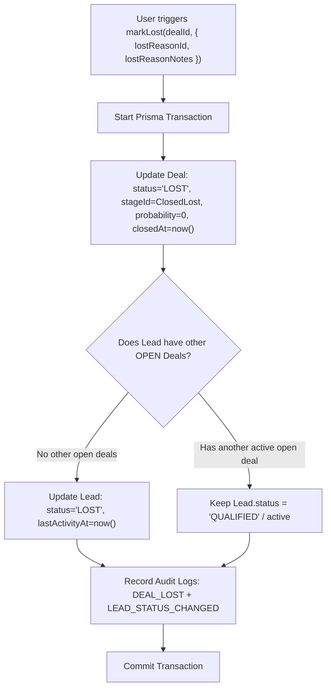
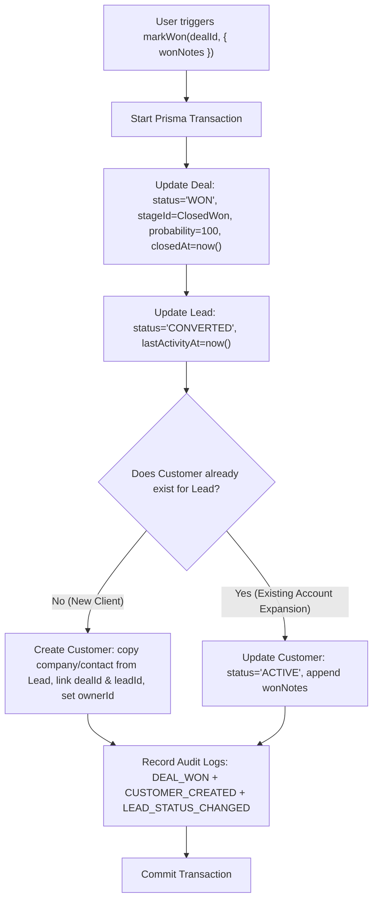
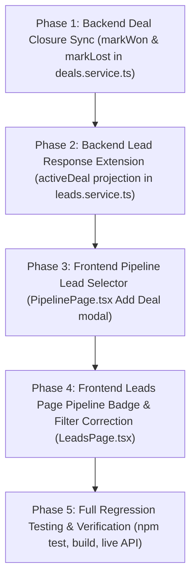

# DigiTechzo CRM — Lead ↔ Pipeline Synchronization Implementation Plan

> **Audit Type**: Implementation Architecture & Design Plan (READ-ONLY)  
> **Date**: October 8, 2026  
> **Target System**: DigiTechzo CRM (NestJS API + React Frontend + PostgreSQL)  
> **Isolated System**: MariaDB (`localhost:3306` — untouched)  
> **Core Architectural Principle**: $\text{LEAD} = \text{CENTRAL / MASTER SALES RECORD}$

---

## 1. Current Implementation Status

Following the successful database cleanup and schema preparation:
- **Lead is Master**: `leadId` is mandatory across `Deal`, `Meeting`, `Proposal`, and `Customer` tables with `ON DELETE CASCADE`.
- **Relational Integrity**: 100% clean baseline. Zero orphan deals, customers, or proposals.
- **Current Operational Gaps**:
  1. `DealsService.markLost()` updates the `Deal` record but leaves `Lead.status` unchanged (e.g. still `QUALIFIED` or `NEW`).
  2. `DealsService.markWon()` sets `Lead.status = 'CONVERTED'`, but does not auto-instantiate a `Customer` account record.
  3. `PipelinePage.tsx` Add Deal modal does not provide a `leadId` selector, which causes deal creation from the Kanban board to fail backend validation.
  4. `LeadsPage.tsx` does not display the Lead's current Pipeline Stage because `LeadResponseDto` does not project active Deal stage information.

---

## 2. Lost Deal $\rightarrow$ Lost Lead Design

### 2.1 Transaction Flow & Logic
When a Deal is marked as **LOST** (via `PATCH /api/v1/deals/:id/lost`):
$$\text{Deal Stage} \longrightarrow \text{Closed Lost} \quad \wedge \quad \text{Deal Status} \longrightarrow \text{LOST} \quad \wedge \quad \text{Lead Status} \longrightarrow \text{LOST}$$



### 2.2 Field & Governance Details
| Entity | Field | Action | Rationale |
| :--- | :--- | :--- | :--- |
| **Deal** | `status` | Set to `'LOST'` | Financial opportunity outcome. |
| **Deal** | `stageId` | Set to Closed Lost stage ID | Positions deal in Closed Lost column on Kanban. |
| **Deal** | `lostReasonId` | Foreign key to `LostReason` (Mandatory) | Governance rule: reason must be categorized. |
| **Deal** | `lostReasonNotes` | Text notes (Optional) | Detailed rep context on why competitor or budget lost. |
| **Deal** | `closedAt` | Set to `new Date()` | Accurate sales cycle duration analytics. |
| **Lead** | `status` | Set to `'LOST'` | Prevents lost leads from appearing as active inbound in SDR lists. |
| **Lead** | `lastActivityAt` | Set to `new Date()` | Freshness tracker. |

> [!NOTE]
> **Lost Reason Retention**: `lostReasonId` and `lostReasonNotes` **remain on the Deal model**. The `Lead` model does not need a redundant `lostReasonId` column because the master commercial context is preserved on the child Deal record and viewable in the 360° Lead timeline.
>
> **Reopening a Lost Lead**: If a client returns after 6 months, reopening the Lead via `PATCH /api/v1/leads/:id/status` (`status: 'CONTACTED'` or `'QUALIFIED'`) or creating a new Deal is natively supported.

---

## 3. Won Deal $\rightarrow$ Customer Design

### 3.1 Transaction Flow & Logic
When a Deal is marked as **WON** (via `PATCH /api/v1/deals/:id/won`):
$$\text{Deal} \longrightarrow \text{WON} \quad \wedge \quad \text{Lead} \longrightarrow \text{CONVERTED} \quad \wedge \quad \text{Customer} \longrightarrow \text{CREATED / LINKED}$$



### 3.2 Field Mapping from Lead/Deal to Customer

| Customer Model Field | Source Value | Fallback / Logic |
| :--- | :--- | :--- |
| `organizationId` | `user.organizationId` | Tenant isolation boundary. |
| `leadId` | `deal.leadId` | Mandatory master record linkage. |
| `dealId` | `deal.id` | Converted revenue deal reference. |
| `companyName` | `lead.companyName` | If `null`, fallback to `lead.fullName`. |
| `contactName` | `lead.fullName` | Primary contact name. |
| `title` | `lead.title` | Job title (nullable). |
| `phone` | `lead.phone` | Contact phone number. |
| `email` | `lead.email` | If `null`, fallback to `noreply@<company-slug>.local`. |
| `status` | `'ACTIVE'` | Default active client status upon conversion. |
| `ownerId` | `deal.ownerId` | Assigned account manager matches the winning sales rep. |
| `customerSince` | `new Date()` | Official customer conversion date. |
| `notes` | `dto.wonNotes` | Initial account notes populated with deal closing notes. |

### 3.3 Duplicate Prevention
- Check `prisma.customer.findFirst({ where: { leadId: deal.leadId, organizationId: user.organizationId, deletedAt: null } })`.
- If an account already exists (e.g. repeat business or multi-deal customer), do **not** fail with `ConflictException`. Instead, link the new Won Deal to the existing Customer account and touch `customer.updatedAt`.

---

## 4. Pipeline $\rightarrow$ Deal $\rightarrow$ Lead (Frontend Design)

### 4.1 UI Workflow in `PipelinePage.tsx`
In the **Add Deal Modal**:
1. Add a **Lead Selector** (combobox/searchable select) populated from `GET /api/v1/leads?status=QUALIFIED,CONTACTED,NEW&limit=50`.
2. When the user selects a Lead:
   - `newDealForm.leadId` is set to `lead.id`.
   - `newDealForm.title` auto-populates as `"${lead.companyName || lead.fullName} - New Opportunity"`.
3. Upon submit, payload sends:
   ```json
   {
     "title": "Boutique - Omnichannel App",
     "value": 500000,
     "stageId": "bc0de882-5e84-487c-aa52-338bc7ab0922",
     "leadId": "f3b67fd8-184f-44fc-b7d5-1fbc60916d1c",
     "probability": 50,
     "expectedCloseDate": "2026-11-30T00:00:00.000Z"
   }
   ```
4. Backend `DealsService.create()` receives `leadId`, validates that the lead exists in the organization, and creates the deal in the selected stage.

---

## 5. Lead $\rightarrow$ Current Pipeline Stage Design

### 5.1 Clean Derivation without Database Redundancy
Rather than introducing a redundant `Lead.stageId` column that requires continuous two-way sync:
1. **Extend Backend `LeadResponseDto`** with a derived `activeDeal` summary:
   ```typescript
   export class ActiveDealSummaryDto {
     id: string;
     title: string;
     stageId: string;
     stageName: string;
     stageOrder: number;
     stageType: string;
     value: number;
     status: string;
   }
   ```
2. In `LeadsService.findAll()` and `findOne()`:
   - Include `deals: { where: { deletedAt: null }, include: { stage: true }, orderBy: { createdAt: 'desc' } }`.
   - If an open deal exists, assign it to `leadDto.activeDeal`.
   - If no open deal exists but historical deals exist, assign the latest Won/Lost deal.
3. In `LeadsPage.tsx`:
   - Render a **Pipeline Stage Badge** in the table row:
     - If `activeDeal` exists: `<Badge variant="outline" className="bg-blue-50 text-blue-700">{lead.activeDeal.stageName}</Badge>`
     - If no deal exists: `<span className="text-txt-muted text-xs">Unassigned to Pipeline</span>`

---

## 6. Automatic Deal Creation Analysis & Recommendation

### The Question:
*Should transitioning a Lead to `QUALIFIED` automatically create a Deal?*

### Analysis:
- **Risk of Silent Auto-Creation**:
  - Automatically creating a Deal in the background on every qualification creates dummy deals with arbitrary ₹0 values and generic titles, distorting pipeline conversion metrics.
  - Not all qualified leads have an immediately known deal scope or closing timeline.
- **Recommended Approach: Guided Explicit Creation**:
  1. When a user qualifies a Lead (or updates status to `QUALIFIED`), the UI displays a callout or modal prompt:
     *"Lead Qualified! Would you like to create an active Opportunity in the Sales Pipeline?"*
  2. The rep confirms deal value, title, and initial stage.
  3. A 1-click `"+ Create Deal"` button is prominent on the Lead 360° header.

---

## 7. File Change Matrix

| Component | File Path | Status | Planned Change Description |
| :--- | :--- | :---: | :--- |
| **Backend Service** | `apps/api/src/modules/deals/deals.service.ts` | **REQUIRED** | Update `markLost()` to sync `Lead.status = 'LOST'`. Update `markWon()` to auto-create `Customer` inside a Prisma transaction. |
| **Backend DTO** | `apps/api/src/modules/leads/dto/lead-response.dto.ts` | **REQUIRED** | Add `activeDeal` / `pipelineStage` summary to `LeadResponseDto`. |
| **Backend Service** | `apps/api/src/modules/leads/leads.service.ts` | **REQUIRED** | Include latest deal & stage in `findAll()` and `findOne()` mapping. |
| **Frontend Pipeline** | `src/pages/pipeline/PipelinePage.tsx` | **REQUIRED** | Add Lead search & selection to Add Deal modal; pass `leadId` to `createDeal`. |
| **Frontend Leads** | `src/pages/leads/LeadsPage.tsx` | **REQUIRED** | Display `pipelineStage` badge in Leads table; fix status filter pills. |
| **Frontend Types** | `src/types/crm.ts` | **REQUIRED** | Update `Lead` interface to include optional `activeDeal` / `pipelineStage`. |
| **Prisma Schema** | `apps/api/prisma/schema.prisma` | **DO NOT CHANGE** | Schema already enforces mandatory `leadId` and correct relations. |
| **MariaDB Database** | Port 3306 | **DO NOT CHANGE** | Completely isolated from CRM operations. |

---

## 8. Transaction Boundaries & Atomicity

All multi-entity operations must run inside `this.prisma.$transaction(async (tx) => { ... })`:

### 8.1 `markWon` Transaction Boundary
```typescript
await this.prisma.$transaction(async (tx) => {
  // 1. Update Deal
  const deal = await tx.deal.update({ ... });
  // 2. Update Lead
  await tx.lead.update({ where: { id: deal.leadId }, data: { status: 'CONVERTED', lastActivityAt: new Date() } });
  // 3. Upsert Customer
  const customer = await tx.customer.upsert({ ... });
  // 4. Audit Logs
  await this.auditService.recordTx(tx, { action: 'DEAL_WON', ... });
  await this.auditService.recordTx(tx, { action: 'CUSTOMER_CREATED', ... });
});
```

### 8.2 `markLost` Transaction Boundary
```typescript
await this.prisma.$transaction(async (tx) => {
  // 1. Update Deal
  const deal = await tx.deal.update({ ... });
  // 2. Check other open deals for this lead
  const openDealsCount = await tx.deal.count({ where: { leadId: deal.leadId, status: 'OPEN', id: { not: deal.id } } });
  if (openDealsCount === 0) {
    await tx.lead.update({ where: { id: deal.leadId }, data: { status: 'LOST', lastActivityAt: new Date() } });
  }
  // 3. Audit Logs
  await this.auditService.recordTx(tx, { action: 'DEAL_LOST', ... });
});
```

---

## 9. RBAC & Security Considerations

1. **BDE Scoping**:
   - BDE can only mark won/lost on deals they own or created.
   - When a Customer is created from a BDE's won deal, the Customer `ownerId` defaults to that BDE.
2. **Admin / Manager Override**:
   - Admins/Managers can assign or reassign any deal, lead, or customer across the organization.
3. **Tenant Isolation**:
   - All transaction queries strictly enforce `where: { organizationId: user.organizationId }`.

---

## 10. Audit Log Requirements

The following immutable audit log actions must be generated:
- `DEAL_WON`: Details `{ value, wonNotes, customerId, leadId }`.
- `DEAL_LOST`: Details `{ lostReasonCode, lostReasonNotes, leadId }`.
- `CUSTOMER_CREATED`: Details `{ companyName, contactName, leadId, dealId }`.
- `LEAD_STATUS_CHANGED`: Details `{ previousStatus, newStatus, trigger: 'DEAL_WON' | 'DEAL_LOST' }`.

---

## 11. Edge Cases & Resilience

1. **Lead with No Email**:
   - If a lead was created with only phone number (common in WhatsApp/inbound leads), `Customer` creation must provide a valid fallback format (e.g. `client-<phone>@domain.local` or make customer email nullable if schema allows, or use lead phone as primary handle).
2. **Concurrent Deal Closures**:
   - If a rep wins Deal A and another rep wins Deal B for the same company, the customer upsert handles the concurrency safely without duplicate key violation.
3. **Reopened Deals**:
   - If a deal is moved out of `Closed Lost` back to `Negotiation`, `Lead.status` resets to `QUALIFIED`.

---

## 12. Recommended Implementation Order (Phased Execution)



---

> [!NOTE]
> **Audit Status**: Complete. No code or database changes have been applied. Awaiting user instruction to proceed with implementation.
